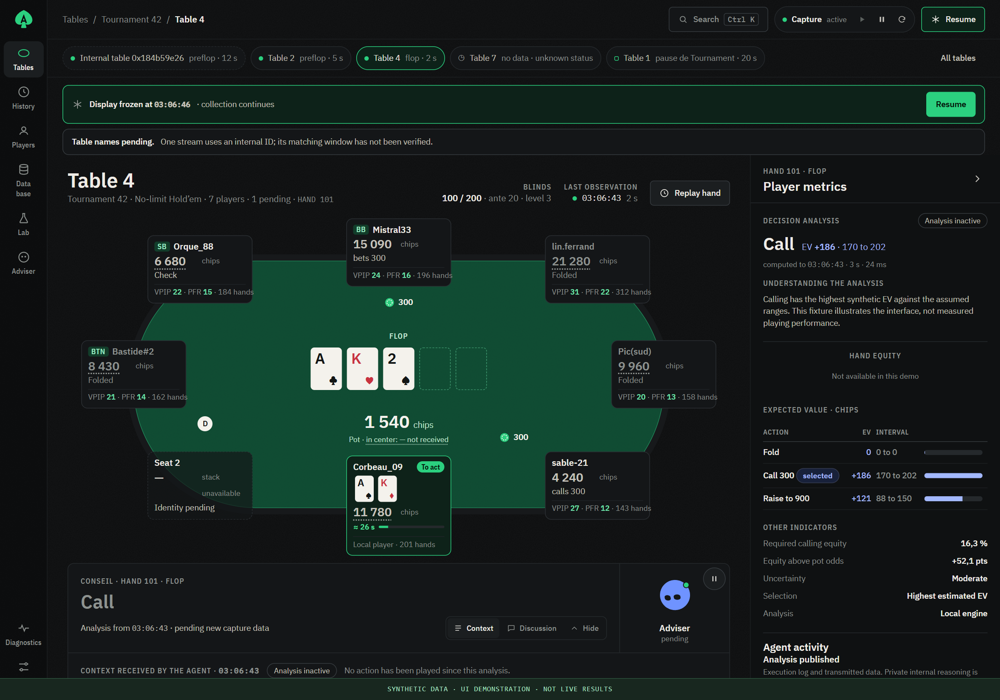
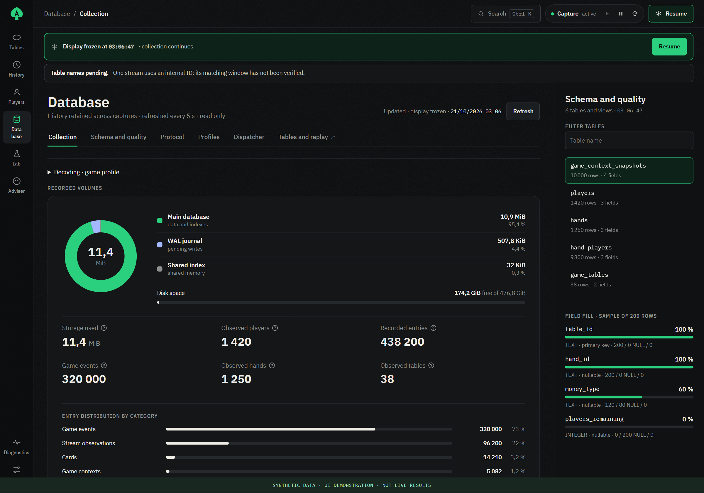
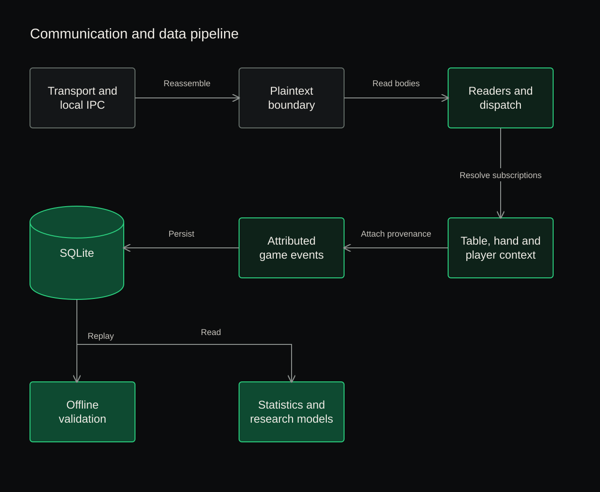
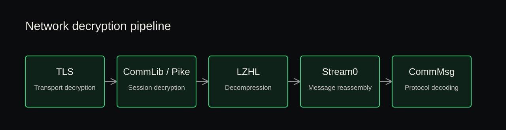

  

**Independent reverse-engineering research into the PokerStars desktop client, its communication pipeline, and the reconstruction of structured poker observations.**

Analyzed Windows builds: **83.0.8.4** and **83.3.2.0**. Protocol findings are tied to the build on which they were established.

The project studies how data travels through a native desktop application: from transport and local inter-process communication to plaintext parsing, message dispatch, application state, and persistent storage.

Its purpose is experimental: connect reverse engineering, artificial intelligence, and game theory through player-behavior analysis, predictive models, decision research, and poker learning tools.

> This repository presents PK Research, its applications, technical architecture, and findings from ongoing work on the PokerStars desktop client.

## Interface preview

The images below show the existing application interface running against an isolated demonstration server. **All displayed players, hands, recommendations, counts, and amounts are synthetic.** They illustrate table observation, decision analysis, collection monitoring, and data-quality inspection.

### Attributed table observations

  

*Demonstration of table state, player context, and the decision-analysis interface. All figures and outputs are fabricated fixtures.*

### Collection and data quality

  

*Demonstration of collection monitoring and explicit missing-field visibility. The displayed percentages illustrate field completeness using synthetic records.*

## Research objectives and experimental method

PK Research uses poker as a test environment for **sequential decision-making under imperfect information**. The technical objective is to turn protocol messages into reproducible observations: a player's action, the information available immediately before it, and the sequence of events that produced that state.

The work connects three layers:

- **Protocol and state reconstruction.** Recover message boundaries and typed payloads, maintain logical channels and subscription images/deltas, and attach each observation to its table, hand, player and session generation. Unknown values, incomplete hands and capture gaps remain explicit.
- **Behavioral inference.** Estimate action probabilities conditioned on the observed decision context: position, stack depth, betting history, opponents and board. Observed actions are behavioral labels, not proof of optimal play. The next dataset/model, **Needle-0**, targets a fixed inventory of **36 required inputs**; their end-to-end network-to-database validation is still in progress.
- **Game-theoretic experimentation.** Compare candidate decisions using card equity, assumed opponent strategies and expected chip value. Evaluate predictive models on held-out observations, study sensitivity to model assumptions, and separate prediction quality from decision quality. Tournament payout utility and equilibrium solving require their own models; a behavioral predictor is not a GTO solver.

The implemented modeling work includes population/player behavioral statistics and an experimental hierarchical logistic-regression model. Native simulation and decision-analysis components provide a separate calculation path. LLM explanations are another consumer of the available context; they are not a substitute for a correctly reconstructed state.

Experiments are based on versioned decoders, source references and deterministic replay. Decision inputs are restricted to information available **before** the action; later cards and outcomes belong to retrospective evaluation. This makes it possible to investigate model calibration, opponent adaptation and strategic uncertainty without treating observed winnings as evidence of an optimal policy. The project is intended for research, offline analysis and learning tools; it does not automate betting actions.

## Project ecosystem

| Project | Purpose | Status |
|---|---|---|
| **PK HUD** | Application and HUD with an observation probe, protocol parser, player metrics, database, logistic-regression behavioral prediction, decision analysis, and LLM advice and explanations. | **Implemented**; source migration and data-quality validation continue. |
| **PK Client** | Independent headless protocol implementation covering transport, logical connections, authentication, subscriptions, and state synchronization. | **Functional POC validated** for the qualified profile; API and web control are a separate workstream. |
| **Reversel Protocol** | Protocol research and documentation, with **150+ protocol-related functions identified**. The project uses the subset relevant to game-state reconstruction and behavioral analysis. | **Partial**, sufficient for current needs. |
| **Needle-0** | Research dataset and associated decision model, built from structured game observations and decision contexts. | **Coming soon**, with strong decision performance as an objective. |

PK HUD is the implemented application. PK Client provides the independent headless client path. Reversel Protocol supplies the technical understanding used by both, while Needle-0 names both the upcoming dataset and its associated decision model. The function count refers to identified code functions.

## Communication and data pipeline

The original investigation follows the native client from transport and local IPC through in-process readers, dispatch and attributed application state:

  

Some internal messages are constructed locally. Others carry subscription images or incremental updates. Their identifiers and paths are documented within their respective namespaces.

### Network decryption pipeline

Captured client traffic is decoded into protocol messages through five stages:

  

## Findings and implemented components

The private research has established and documented:

- The active local transport and IPC path for analyzed client builds.
- Reconstruction of fragmented TLS records, export of the official client's TLS/Pike session secrets, and reproducible network decoding through Pike, LZHL and Stream0 on a qualified capture.
- Parts of the message-processing pipeline, including native readers, virtual tables, type information, dispatchers, and subscription callbacks.
- Selected table and tournament structures covering identities, seats, hand state, actions, cards, amounts, and configuration.
- The distinction between initial subscription images, later updates, and state invalidation across generations.
- Offline replay and source-to-database checks for selected recorded sequences.
- Decision-context reconstruction and experimental behavioral modeling from observed public actions.

Each finding is documented with its analyzed build, supporting evidence, and validation scope.

## What data matters?

The useful unit of analysis is a **decision with its preceding context**.

| Information | Research role |
|---|---|
| Player, table, hand, seat, session generation, and event order | Keep observations attached to the correct situation. |
| Game format, betting rules, blinds, antes, and amount units | Make comparisons between compatible situations. |
| Position, active opponents, stacks, contributions, board, and pots | Describe what was known before the action. |
| Amount to call, offered actions, raise bounds, and decision freshness | Distinguish actual opportunities from unavailable choices. |
| Observed action and amount | Provide behavioral observations and labels. |
| Tournament population, payouts, bounty context, and entry conditions | Support contextual analysis where those fields are qualified. |
| Capture gaps, source references, decoder versions, and corrections | Make results auditable and prevent duplicate or misleading observations. |

The analysis uses public game observations and the local player's own context. Revealed cards and hand outcomes support retrospective analysis, with decision inputs restricted to information available before the action.

## Tools and engineering

The work combines:

- **Static analysis:** historical IDA work and current REA/Ghidra analysis.
- **Runtime investigation:** targeted Frida instrumentation for session-secret export, Windows API/IPC analysis, and guarded native entry-point research.
- **Network analysis:** PCAPNG capture, Wireshark/TShark TLS decoding, and deterministic CommLib Pike/LZHL/Stream0 replay.
- **Data engineering:** Python decoders, SQLite persistence, deterministic offline replay.
- **Automation and validation:** PowerShell tooling, finite fixtures, source manifests, and regression tests.

## Publication scope

This public repository presents the project's goals, applications, architecture, and research findings. The underlying implementation and detailed evidence are maintained in the private research workspace.

Needle-0 brings together the planned research dataset and its associated decision model, extending the work from protocol observation to data-driven experimentation.

## Project context

This is an independent personal research effort focused on the desktop client distributed to end users, combining client-side static analysis, runtime observation, and offline experimentation.

PokerStars is a trademark of its respective owner. PK Research is an independently developed project.

## Contact

For discussion of the methodology, architecture, or research findings:

**[nathantbl1@gmail.com](mailto:nathantbl1@gmail.com)**
