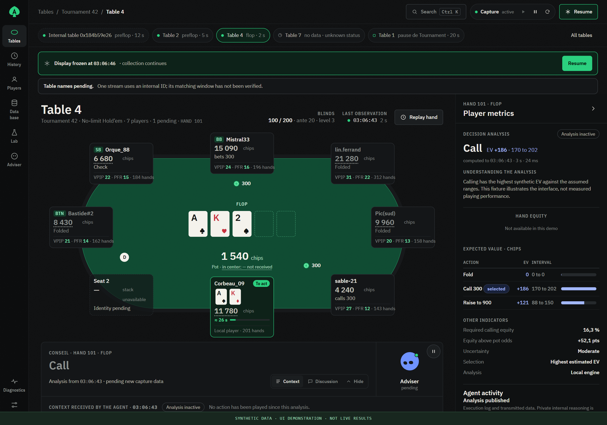
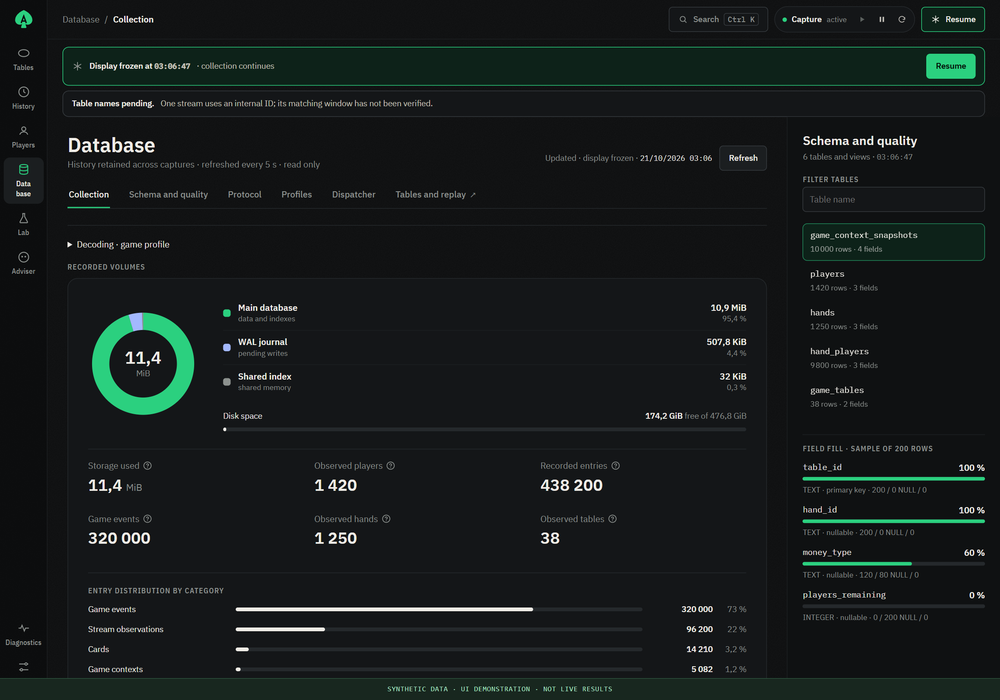
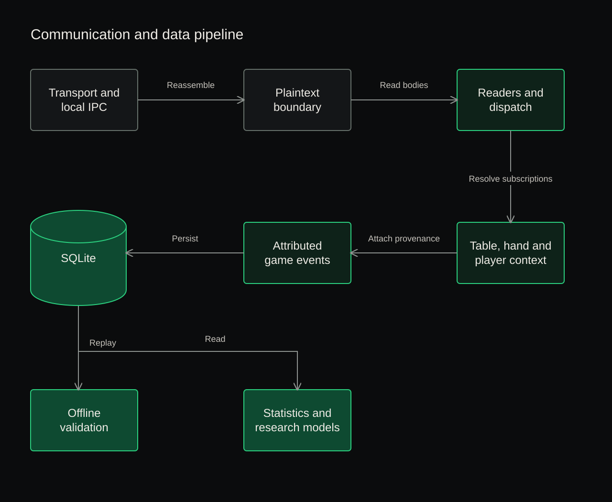
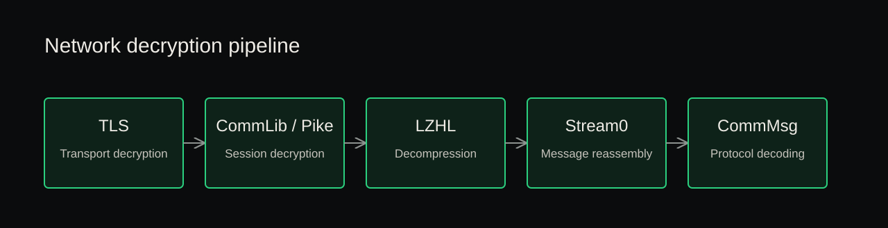

  

**Independent research into the PokerStars desktop client, its communication pipeline and the reconstruction of structured poker observations.**

PK Research connects protocol analysis, player modeling and decision research.
The project follows data from transport and local communication through
plaintext parsing, message dispatch, application state and persistent storage.
The private workspace includes a table observation interface, a headless
mini-client, recorded history, replay tools and experimental decision analysis.

The analyzed Windows builds include **83.0.8.4** and **83.3.2.0**. Protocol
findings retain the build and evidence on which they were established.

This public repository presents the project, selected illustrations and its
research design. Implementation sources and detailed evidence remain in the
private research workspace.

## Interface preview

These images show the existing interface running against an isolated
demonstration server. **All displayed players, hands, recommendations, counts
and amounts are synthetic.** They illustrate table observation, decision
analysis, collection monitoring and data-quality inspection.

### Attributed table observations

  

*Table state, player context and the decision-analysis interface shown with fabricated fixtures.*

### Collection and data quality

  

*Collection monitoring and missing-field visibility. The displayed percentages come from synthetic records.*

## Research objectives

Poker provides a setting for studying sequential decisions under imperfect
information. The first task is to reconstruct an observation with a known
source, table, hand, player and position in the event sequence. That makes it
possible to study behavior without silently filling gaps or using later
information.

The work has three connected parts.

- **Protocol and state reconstruction.** Decode messages, track logical
  connections and subscription updates, and preserve identity across table
  and session generations. Unknown values and incomplete hands remain explicit.
- **Behavioral modeling.** Predict action probabilities from the current
  context and the player's earlier observations. An observed action is a
  behavioral label, not evidence that the action was optimal.
- **Decision research.** Compare candidate actions using card equity,
  declared opponent policies and expected chip value. Prediction quality,
  simulated decision quality and performance in a real game are evaluated
  separately.

The existing modeling work includes population and player statistics and
**P6**, an experimental hierarchical logistic-regression model. Native equity
and EV calculations form a separate numerical path. The LLM adviser can
select from evaluated candidate actions and explain its choice. Recorded
replay and rendering checks establish parts of that workflow, not a general
strategic advantage.

Experiments use versioned decoders, source references and deterministic
replay. Inputs follow an explicit information boundary. Current exported
observations precede the received action notification, which does not by
itself prove that every feature preceded the human's choice. Later cards,
outcomes and target amounts stay outside that target's inputs.

The project supports research, offline analysis and learning tools. It does
not automate betting actions.

## Project ecosystem

| Project | Purpose | Current status |
| --- | --- | --- |
| **PK HUD** | Table observation, player metrics, durable history, replay, decision analysis and LLM advice. | Implemented. Data coverage and end-to-end validation remain specific to each source and task. |
| **PK Client** | Headless protocol implementation with transport, logical connections, authentication, subscriptions and state synchronization. | The qualified protocol path, API and web controls exist. Coverage depends on the profile and scenario validated. |
| **Reversel Protocol** | Protocol research supporting the application and client. Earlier work identified more than 150 protocol-related functions. | Partial. Findings retain their build, evidence and validation scope. |
| **Needle-0** | Player-history representation learning through PPE-Predict, followed by a policy trained in simulation through PPE-Policy. | Architecture defined. Causal data preparation and lightweight baseline experiments exist. The PPE neural network has not been trained. |

PK HUD is the application. PK Client provides the independent client path.
Reversel Protocol documents the underlying mechanisms. Needle-0 builds on the
resulting observations to study player behavior and adaptation.

## Needle-0: Poker Player Encoder

Needle-0 learns from structured histories rather than assigning a fixed label
to a player. A hand encoder summarizes events within each past hand. A history
encoder combines those summaries in time order. A separate branch processes
the current situation. Together, they can represent how the same player
behaves differently across stack depths, positions and betting contexts.

The design has two stages.

1. **PPE-Predict** estimates action probabilities and conditional bet-size
   distributions from the current observation and player representation.
2. **PPE-Policy** uses that representation to train a policy and value function
   in simulation, starting with small games before restricted NLHE subgames.

Observed amounts are model inputs. The next action and its amount are targets.
Reliability is measured outside the neural network using held-out performance
on comparable cases. This keeps the first version free of a mandatory neural
confidence head.

The private review verified an export of **9,144 reduced-action examples from
10 sources** and the artifacts of **nine lightweight baseline models**.
These are data and baseline results, not results from a trained PPE Transformer.
Legal-action masks, sizing labels and independent evaluation groups still have
limited coverage. Two additional cohorts can support temporal pilot studies
of already observed players. They do not establish generalization to unseen
players or strategic profitability.

The earlier inventory of 36 information requirements describes source and
context needs. It is not a vector of 36 scalar model inputs.

Read the [Needle-0 technical specification](docs/models/needle-0/MODEL.en.md)
for the architecture, equations, training procedure, external reliability
layer and implementation plan.

## Communication and data pipeline

The original investigation follows the native client from transport and local
communication through in-process readers, dispatch and attributed application
state. The network and connected mini-client paths reuse common state
reconstruction, presentation and SQL persistence components.

  

Some internal messages are constructed locally. Others carry subscription
images or incremental updates. Identifiers and paths retain their own
namespaces.

### Network decoding

Captured traffic is decoded through the TLS, CommLib Pike, LZHL, Stream0
and CommMsg stages shown below.

  

## Findings and implemented components

The private work has documented the local transport and IPC paths of analyzed
builds, fragmented TLS reconstruction and reproducible Pike, LZHL and Stream0
decoding on qualified captures. It also covers native readers, dispatchers,
subscription callbacks and selected table and tournament structures.

State reconstruction distinguishes initial images, later updates and
invalidation across generations. Selected recordings have passed replay and
source-to-database checks. These findings support attributed actions, cards,
amounts, seats and decision context within their documented scope.

The observation stack, headless client and numerical decision engine are
implemented components. Complete economic state, hidden-card beliefs, rake,
tournament utility and strategic performance require their own validation.

## What data matters?

The useful unit is a decision paired with the information available before
its declared boundary.

| Information | Research role |
| --- | --- |
| Player, table, hand, seat, session generation and event order | Keep each observation attached to its situation |
| Game format, betting rules, blinds, antes and units | Compare compatible situations |
| Position, opponents, stacks, contributions, board and pots | Describe the available context |
| Amount to call, legal actions, raise bounds and freshness | Distinguish real opportunities from unknown choices |
| Observed action and amount | Supply behavioral labels |
| Tournament population, payouts, bounties and entry conditions | Add context where those fields are verified |
| Capture gaps, source references, reader versions and corrections | Make results reproducible and prevent duplicate or misleading records |

Public game observations and the local player's permitted context are kept
separate from hidden opponent information. Revealed cards and outcomes can
support later analysis without leaking into earlier decision inputs.

## Tools and engineering

The workspace combines historical IDA work with current REA analysis,
targeted Frida instrumentation, Windows API and IPC investigation, network
capture and replay, Python decoders and SQLite persistence. PowerShell tools,
source manifests, finite fixtures and regression tests support reproducibility.

## Publication scope

This repository contains the public overview, existing illustrations and the
Needle-0 design document. Implementation code, individual game records,
private configuration, credentials and detailed experimental evidence remain
in the private workspace.

This is an independent personal research project. PokerStars is a trademark
of its respective owner.

## Contact

For discussion of the methodology, architecture or research findings:

**[nathantbl1@gmail.com](mailto:nathantbl1@gmail.com)**
