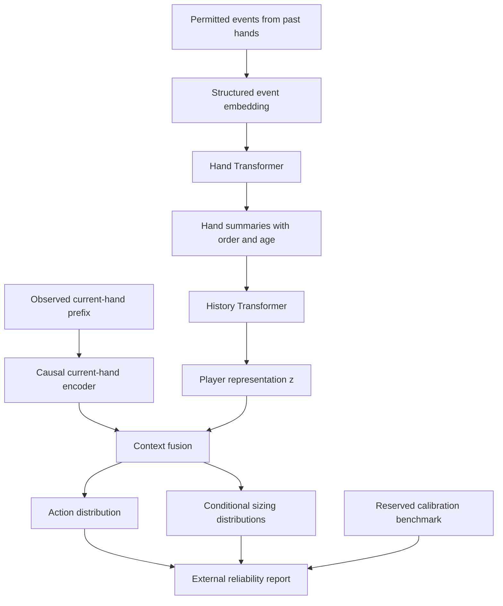

# Needle-0: Poker Player Encoder

## Model, mathematics and implementation

**Document version:** 0.2, English edition, November 4, 2026.

**Architecture:** PPE-Predict and PPE-Policy share a player history encoder.

**Current status:** The architecture is defined. Data preparation and lightweight baselines exist in the private research workspace. The PPE neural network has not been implemented or trained yet.

### Abstract

Needle-0 learns a representation of a poker player's behavior from the hands
that an observer has seen. One Transformer encodes the events within each
past hand. A second Transformer combines those hand representations in time
order. A separate branch processes the current situation. Together, the
player representation and the current context predict actions and bet sizes.
This part of the system is called **PPE-Predict**. A later stage uses the
representation to train a policy and a value function in simulation. That
part is called **PPE-Policy**.

The representation is not a fixed label such as "aggressive". It can encode
how a player behaves in different situations. The prediction also receives
the current context, so the same player representation can lead to different
predictions at different stack depths, positions or betting histories.

An external evaluation layer measures reliability on comparable cases. It
does not require an extra confidence network. This document explains the
model and how to implement it, while separating existing data tools and
baselines from the neural components that still need to be built.

**Keywords:** player representation, imperfect information, hierarchical
Transformer, causal history, conditional prediction, external calibration,
policy learning.

## 1. Design and scope

The model keeps the hand encoder, history encoder and current-hand branch
defined in the PPE v0.1 proposal. The following decisions guide the first
implementation.

| Design choice | What it means in practice |
| --- | --- |
| Learn behavior from contextual observations | Player names are not learned embeddings or personality classes |
| Supply the current situation to the prediction head | A player can behave differently depending on the situation |
| Include observed amounts in the inputs | Historical actions retain their amounts and their meaning |
| Predict action type and sizing separately | The next amount is a target, not an input for that same decision |
| Measure reliability outside the network | The first version does not need a neural confidence head |
| Separate prediction from strategy | Predicting an action well does not establish the quality of a response |

The dimensions below are starting values. They are not measured optima.
Summary tokens and pseudocode describe one way to implement the agreed
architecture. They do not describe an existing PPE implementation.

P6 is an earlier behavioral regression model. It is separate from Needle-0
and can serve as a historical baseline. Collection and interface milestones
also called P6 use a different naming scheme.

The first strategic experiments take place offline in a simulator. Connecting
PPE to a table adviser is a separate integration task.

## 2. Notation and prediction task

| Symbol | Meaning |
| --- | --- |
| $j$ | The focal player whose behavior is being modeled |
| $t$ | The information boundary for the target decision |
| $v$ | The observer's permitted viewpoint |
| $x_t^v$ | The current observation available from that viewpoint |
| $H_j^{<t,v}$ | The focal player's history available strictly before the target |
| $H_{j,k}^{<t,v}$ | The permitted fragment of past hand $k$ |
| $C_t^v$ | The observed prefix of the current hand |
| $u_{j,k}$ | The representation of a past hand |
| $z_j^t$ | The player's behavioral representation |
| $a_t$ | The target action type |
| $s_t$ | The sizing class for an aggressive action |
| $m_t$ | A verified legal-action mask for the target decision |
| $K$ | The number of earlier decisions by the focal player used as support |
| $H$ | The number of encoded past hands, which is different from $K$ |

The behavioral task is to approximate

$$
q_{\theta,\phi}(a_t,s_t\mid x_t^v,H_j^{<t,v}).
$$

The model first predicts the action, then the amount conditional on an
aggressive action.

$$
\begin{aligned}
z_j^t &= f_\theta(H_j^{<t,v}), \\
q_{\theta,\phi}(a_t,s_t\mid x_t^v,H_j^{<t,v})
&=q_\phi(a_t\mid x_t^v,z_j^t)\,
q_\phi(s_t\mid a_t,x_t^v,z_j^t).
\end{aligned}
$$

The second distribution is used for bets and raises. Network weights are
shared across players. Identifiers are used to assemble episodes and data
splits, but they are not given to the network as player-specific features.

The prediction head explicitly receives $x_t^v$. Keeping the same $z_j^t$
therefore does not force the same prediction when the stack, position or
amount to call changes. The past-hand encoder also receives the context in
which earlier actions occurred.

## 3. Data and information boundaries

### 3.1 Existing data preparation

The private workspace contains an exporter called `tools/needle_dataset`.
Its `needle-causal-dataset-v0.1.1` format has eight JSONL tables and a
manifest. This existing format can feed the first PPE implementation.
Parquet is a possible later storage format, not a prerequisite.

| Table | Purpose |
| --- | --- |
| `sources` | Source provenance, journal boundaries, hashes and reader policy |
| `hands` | Hand and table context, participants, time range and known completeness |
| `events` | Ordered events, actors, amounts and evidence references |
| `observations` | Information available before a target, viewpoint and quality |
| `labels` | Target action and amount, with eligibility for each task |
| `examples` | Episode references, history boundary, support depth and exclusions |
| `history_index` | Focal-player decisions ordered within a verified identity scope |
| `partitions` | Assignment or exclusion under a named evaluation protocol |

The `Dataset` reader checks the manifest, file hashes, joins and splits.
`Dataset.input` returns the current observation, permitted past hands, the
current-hand prefix and coverage metadata. It is the starting point for the
tensorizer. It does not yet return PPE tensors.

These implementation paths refer to the private workspace. The public
repository contains the design and project overview, not these source files.

### 3.2 Information that the model may use

Every feature must satisfy

$$
\operatorname{available\_at}(\text{feature})\prec t.
$$

The ordering comes from the source, message position and command ordinal.
A reception time or SQL insertion time is not treated as a shared clock
between sources unless that relationship has been verified.

Inputs contain only cards visible from the declared viewpoint. Hidden
opponent cards, future board cards, the target action, its amount and its
final duration are excluded from the prefix. A card revealed in an earlier
hand can be used once its availability is established.

The current data contract reconstructs the observation before the received
action notification. That boundary does not by itself prove that every
feature was available before the human chose the action. The task and its
results retain this distinction, especially for balances and timing.

### 3.3 Event representation

An event contains the categories and numerical values needed to describe it.
These include its action or event type, street, whether the actor is the
focal player, relative seat position, visible cards, observed amounts and
their meaning, known stacks and contributions, and the available game
context. Ordering, verified age, missing-value masks and quality indicators
travel with those values.

Events remain structured data. They are not converted into natural-language
sentences. Names and join keys stay in the loader metadata, outside neural
inputs.

A missing value is different from a real zero. For a numerical value $r$
with availability mask $b$, the tensorizer uses

$$
\widetilde r=
\begin{cases}
T_{\mathrm{train}}(r),& b=1,\\
0,& b=0.
\end{cases}
$$

The transformation $T_{\mathrm{train}}$, its parameters and the mask are
versioned. Normalization is fitted on training data and then frozen. The
mask lets the network distinguish the fill value from an observed zero.

### 3.4 Amounts and units

Past amounts are normal model inputs. For an aggressive target, the labels
can distinguish the amount added, the total amount reached and a ratio to
a verified reference pot.

$$
\Delta_t=\text{amount added},\qquad
R_t=\text{total amount reached},\qquad
r_t=\frac{\Delta_t}{P_t}.
$$

$P_t$ must be defined and verified before the action. These quantities are
not interchangeable. A received amount whose role is unknown is not silently
treated as a betting increment.

Raw values and units are retained. Conversion to big blinds requires a
verified positive big blind. A pot ratio requires a verified positive
denominator. An unavailable ratio stays missing. The future target amount
is used only to calculate the loss.

### 3.5 Partial hands and history limits

The model receives permitted hand fragments with explicit coverage. A
partial sequence is not completed with later events or marked as a fully
verified hand.

The initial budget is 64 past hands and 64 events per fragment, with a later
extension to 256 hands. Longer sequences require an explicit, versioned
choice such as a larger budget, fragmentation or a recorded exclusion.
Dropped events must not be counted as encoded support.

The few-shot curve uses $K\in\{0,10,30,100,300,1000\}$ earlier decisions
by the focal player. The number of hands and events actually encoded is
reported separately. The public prefix of the current hand remains available
at every value of $K$.

## 4. Hierarchical encoder

### 4.1 Architecture



Reliability is outside the neural path. It is not a fourth encoder and does
not change the player representation.

### 4.2 Event embeddings

For event $e_{k,\ell}$ in hand $k$, the input vector has width $d$.

$$
v_{k,\ell}=
W_{\mathrm{in}}\operatorname{concat}
\left(
\operatorname{Emb}(c_{k,\ell}),
\widetilde n_{k,\ell},
b_{k,\ell},
q_{k,\ell}
\right)
+p_{k,\ell}.
$$

$c$ holds categorical values, $\widetilde n$ holds normalized numerical
values, $b$ contains availability masks, and $q$ describes quality and
visibility. The term $p$ encodes sequence order. The focal player is marked
through roles and relative positions, not a username embedding.

### 4.3 Encoding a past hand

The hand encoder is shared across hands and players.

$$
u_{j,k}=E_{\mathrm{hand},\theta}(v_{k,1},\ldots,v_{k,L_k})
\in\mathbb R^d.
$$

One implementation convention is to add a learned `[HAND]` summary token
and read its final state. Padding events are masked. Attention within an
already available past-hand fragment can be bidirectional. Events received
after the target boundary cannot be used to complete that fragment.

The attention operation is

$$
\operatorname{Attention}(Q,K,V,M)=
\operatorname{softmax}\!\left(\frac{QK^\top}{\sqrt{d_h}}+M\right)V.
$$

$M$ is zero for permitted connections and $-\infty$ for forbidden ones.
The attention blocks follow the [Transformer architecture](https://arxiv.org/abs/1706.03762).

### 4.4 Encoding the player's history

Each hand summary receives ordering information and an age feature when
that age is known.

$$
\begin{aligned}
\bar u_{j,k}&=u_{j,k}+p_k^{\mathrm{hand}}+
ho(\Delta t_k,b_k^{\mathrm{time}}),\\
z_j^t&=W_z\,E_{\mathrm{history},\theta}
(\bar u_{j,1},\ldots,\bar u_{j,H})+b_z.
\end{aligned}
$$

The time mask records an unknown age rather than inventing a duration.
A `[PLAYER]` token provides the history summary, which is projected to
$z_j^t\in\mathbb R^{d_z}$.

An empty history is a valid input. A learned empty-history summary and zero
coverage support predictions at $K=0$. Training episodes include this case.
The model does not need a personality label or a separate confidence label
attached to the representation.

### 4.5 Encoding the current hand

The current branch produces

$$
c_t=E_{\mathrm{current},\theta}(C_t^v,x_t^v)\in\mathbb R^d.
$$

It respects the causal order of the current prefix. With causal attention,
a `[STATE]` summary token is placed after the prefix so it can read all
permitted events. Placing it before the prefix with the same attention mask
would prevent it from doing that.

Visible cards, stacks, positions, the amount to call and current context enter
this branch with their availability masks.

### 4.6 Fusion and initial dimensions

The prediction head combines the current state, player representation and
coverage metadata $\kappa_t$.

$$
h_t=\operatorname{MLP}_\phi
\left(\operatorname{concat}(c_t,z_j^t,\kappa_t)\right).
$$

Nonlinear fusion allows the context and player representation to interact.
$\kappa_t$ describes how much history is available, its known age and missing
information. These are input features, not confidence targets.

| Parameter | Initial setting |
| --- | ---: |
| Hidden width $d$ | 256 |
| Player representation width $d_z$ | 128 |
| Hand, history and current-hand blocks | 2 / 2 / 2 |
| Attention heads | 8 |
| Feed-forward width | 1,024 |
| Dropout | 0.1 |
| Initial history and later extension | 64 / 256 hands |
| Initial fragment budget | 64 events |

The parameter count must be measured on the instantiated network. The earlier
estimate of 5 to 15 million parameters is not a count from an existing
implementation. Pooling, activation and normalization choices belong in
the checkpoint configuration as well as its dimensions.

## 5. PPE-Predict outputs

### 5.1 Action probabilities

The ordered action vocabulary is

$$
\mathcal A=(\mathrm{fold},\mathrm{check},\mathrm{call},\mathrm{bet},\mathrm{raise}).
$$

The action head returns logits $\ell_t=W_a h_t+b_a$. When the legal-action
mask has been fully verified, probabilities are

$$
q_\phi(a\mid x_t^v,z_j^t,m_t)=
\frac{\mathbf1_{\{m_t(a)=1\}}\exp(\ell_{t,a})}
{\sum_{a'\in\mathcal A}\mathbf1_{\{m_t(a')=1\}}\exp(\ell_{t,a'})}.
$$

An unknown mask is not silently replaced with "every action is legal".
The `action_reduced` task predicts an observed action category without
certifying the full action menu. The `action_masked` task requires a verified
mask for that decision. The output retains the task status. An empty mask
or a mask inconsistent with its label produces an explicit diagnostic.

### 5.2 Sizing probabilities

For $a\in\{\mathrm{bet},\mathrm{raise}\}$, the sizing head returns

$$
q_\phi(s\mid a,x_t^v,z_j^t)
=\operatorname{softmax}(W_{s,a}h_t+b_{s,a})_s.
$$

This can be implemented as two conditional outputs. The shared representation
does not receive the future action to predict that action. During sizing
training, the observed target action selects the relevant conditional output.

The sizing codebook records the quantity's meaning, unit, class boundaries
and conversion to a legal amount. It is defined from training data and frozen
for validation and test. Verified amount bounds can mask unavailable classes.

All-in is a status associated with an action and an amount, not a sixth
action category. A class spanning several amounts cannot be presented as
an exact observed amount. Unknown all-in status remains unknown.

### 5.3 Loss and partial labels

For a fully eligible example, the prediction loss is

$$
\mathcal L_i=-\log q_\phi(a_i\mid x_i,z_i)
-\lambda_s\mathbf1_{\{a_i\in\{\mathrm{bet},\mathrm{raise}\}\}}
\log q_\phi(s_i\mid a_i,x_i,z_i).
$$

With action and sizing eligibility masks $b_i^a$ and $b_i^s$, and example
weights $w_i$, the batch loss becomes

$$
\mathcal L_{\mathrm{pred}}=
\frac{\sum_iw_i\left(b_i^a\mathcal L_i^a+
\lambda_s b_i^s\mathcal L_i^s\right)}
{\sum_iw_i b_i^a}.
$$

The sizing mask requires an aggressive action and a verified quantity
compatible with the selected codebook. Missing labels are not zero-sized
bets. Batches without eligible targets are skipped. If a run has no eligible
sizing labels, that head remains untrained and is not published as validated.

The starting value is $\lambda_s=1$, selected later on validation data.
Different history lengths for the same target do not multiply its total
training weight. Comparisons use the same targets and weighting.

## 6. Behavioral training

### 6.1 Episodes and support length

An episode combines the focal player's permitted history, a current prefix
and one or more later decisions. The loader varies support length and
includes empty histories. The network is fitted on training data and selected
on validation data. Its weights then stay fixed at every test value of $K$.

Changing $K$ changes the support, not the weights, vocabulary, normalizer or
sizing classes. The primary comparison uses the same targets at each depth.
Results for the naturally available population at each $K$ are reported
separately because those populations can differ.

### 6.2 Initial optimization settings

| Parameter | Starting value |
| --- | --- |
| Optimizer | AdamW |
| Learning rate | $3\times10^{-4}$ |
| Weight decay | $10^{-2}$ |
| Gradient clipping | Norm 1 |
| Dropout | 0.1 |
| Indicative empty-history probability | 0.2 |
| Pilot seeds | 11, 23, 47 |
| Checkpoint selection | Validation log-loss for the declared task |

Batch size depends on actual sequence lengths and measured resource use.
Stopping rules, checkpoint selection and compute budget are fixed before
the test is opened. An initial fit on a tiny subset checks whether the code
can learn its labels. That check is not evidence of generalization.

### 6.3 What each split can establish

| Evaluation split | Question |
| --- | --- |
| Temporal split with known focal players | Does earlier history help predict their later decisions? |
| Reserved focal players | Can the encoder adapt to players absent from training? |
| Entirely reserved participant groups | Does performance hold with disjoint participants in targets and support? |
| Reserved domain | Does the model transfer to a declared format, stake or period? |

Hands remain indivisible. Purging follows the selected protocol and accounts
for support and other participants. A local identity scope is not treated
as a globally verified person or a cross-session identity.

Transformations and hyperparameters use training and validation data.
Reliability calibration uses data separate from weight fitting. A reserved
part of validation may serve that purpose, while the final test stays
independent.

## 7. External reliability

### 7.1 Keep prediction and reliability separate

The network returns action and sizing distributions. An external layer
measures how those predictions perform on comparable examples. It can group
cases by support depth, history age, street, game format, stack depth and
missing information.

This layer does not require a confidence head. Coverage still enters the
network because it helps interpret the history, but coverage is not itself
a reliability estimate.

Unpredictable actions and an unreliable model are different things. A
50 percent call and 50 percent raise prediction can be well calibrated for
a player who genuinely mixes those actions. Maximum probability or entropy
alone cannot establish whether the model understands that situation.

### 7.2 Estimate performance on comparable cases

A fixed grouping rule $g(\eta)$ uses characteristics available in example
$\eta$. For a group $G$ and loss $\ell$, empirical risk is

$$
\widehat R_G=
\frac{\sum_{i:g(\eta_i)=G}w_i\,
\ell(q_i,y_i)}{\sum_{i:g(\eta_i)=G}w_i}.
$$

Log-loss measures probabilistic performance. The Brier score is also reported.

$$
\ell_{\mathrm{Brier}}(q_i,y_i)
=\sum_{a\in\mathcal A}\left(q_i(a)-\mathbf1_{\{y_i=a\}}\right)^2.
$$

The report pairs risk with sample size, the number of dependence groups,
an interval when one can be estimated, and the domain covered. Intervals
respect relevant session or player blocks instead of treating every action
as independent.

Any displayed scalar must state what it measures, such as estimated expected
loss. It is not called "the probability that this advice is correct" without
validation of that interpretation. When comparable examples are insufficient,
the status is `unknown` or `insufficient_support`.

### 7.3 Calibration after training

Optional external calibration adjusts probabilities without retraining the
encoder. One approach fits a positive temperature $T$ on reserved calibration
data.

$$
q_T(a)=\operatorname{softmax}\!\left(\frac{\ell_a}{T}\right).
$$

It retains the same verified legal mask. This procedure is separate from
the table of risk by comparable situation. It is a post-processing method
to evaluate, not an automatic guarantee in this domain. See
[Guo et al. on network calibration](https://proceedings.mlr.press/v70/guo17a.html).

Each reliability report identifies the model, grouping rule and calibrator.
A new network version requires new validation before earlier reliability
measurements can be reused. The baseline work has not yet established a
calibrated reliability score for PPE.

## 8. PPE-Policy

### 8.1 Information available to the policy

The policy receives its information set $I_t$, including its own private
cards, public facts and permitted history. It also receives opponent
representations.

$$
\pi_\psi(a_t\mid I_t,z_1^t,\ldots,z_m^t),
\qquad V_\omega(I_t,z_1^t,\ldots,z_m^t).
$$

Heads-up play needs one opponent representation. A later multiway extension
will associate each representation with its position and stack without
depending on an arbitrary ordering of identifiers. That extension has its
own evaluation protocol.

The simulator knows hidden cards to settle hands. Its observation interface
does not expose them to the encoder or policy. Predicted action frequencies
are not exact card ranges.

### 8.2 Objective and training

The initial reward is net chip gain in big blinds in a defined game without
rake. Rake, tournament payouts and bounties need explicit conditions and
utility functions.

The selected algorithm is PPO with actor and critic heads. Let the policy
ratio be $\varrho_t=\pi_\psi(a_t\mid I_t,z)/\pi_{\mathrm{old}}(a_t\mid I_t,z)$
and let $\widehat A_t$ estimate advantage. The actor loss is

$$
\mathcal L_{\mathrm{actor}}=
-\mathbb E_t\left[
\min\left(\varrho_t\widehat A_t,
\operatorname{clip}(\varrho_t,1-\varepsilon,1+\varepsilon)
\widehat A_t\right)\right].
$$

Training adds a value loss and an entropy term. The objective follows
[Schulman et al. on PPO](https://arxiv.org/abs/1707.06347). Later experiments
may add the reference-policy regularization and auxiliary prediction loss
already described in the design. These terms do not establish equilibrium
or exploitability guarantees.

The first NLHE comparison holds a pretrained encoder fixed and compares it
with an encoder trained without that pretraining, using comparable strategic
budgets. Fine-tuning the pretrained encoder is a separate experiment. Changes
to encoder weights invalidate its cached representations.

### 8.3 Opponents and progression

The simulated population includes reference policies, coherent variants
with controlled biases and earlier checkpoints. Opponents persist across
several hands so that history can help. The network does not receive their
generator identifiers or hidden parameters.

Entire opponent families, including changing policies, are reserved for
testing. Experiments progress from Kuhn and Leduc to heads-up NLHE river
subgames with a limited betting tree, then to turn, flop and broader formats.
Small games validate mechanisms and visibility. They do not establish NLHE
transfer.

CFR, MCCFR and best responses provide comparators where the game supports
them. Strategic evaluation separately measures EV, variation by opponent,
independent sessions and cost. A result on a restricted tree retains that
scope.

## 9. Implementation plan

### 9.1 Reuse existing components

| Component | Private workspace location | Status |
| --- | --- | --- |
| Export checks and `Dataset.input` | `tools/needle_dataset/dataset.py` | Existing |
| Temporal evaluation plans | `tools/needle_dataset/experiments.py` | Existing |
| Context and statistical baselines | `tools/needle_dataset/benchmark.py` | Existing |
| Corrected scientific evaluation | `tools/needle_scientific_benchmark/` | Existing softmax baselines |
| PPE tensorizer and Transformers | `tools/needle_ppe/` | Proposed location, not implemented |
| External calibration and risk estimates | `tools/needle_ppe/reliability.py` | Not implemented |
| Policy and simulator adapters | `tools/needle_ppe/policy.py` and adapters | Not implemented |

Archived code can be reused from pinned Git objects. Its version belongs in
the experiment manifest. Changing a reader requires contract checks and
cannot silently preserve the identity of an older experiment.

The proposed module layout is

```text
tools/needle_ppe/
  config.py        # Versioned configuration and schema
  tensorize.py     # Dataset.input to tensors and masks
  model.py         # Embeddings, three encoders and prediction heads
  losses.py        # Losses and task eligibility
  train.py         # Training and validation-based selection
  predict.py       # Frozen inference and input/output contracts
  reliability.py   # External calibration and empirical risk
  evaluate.py      # Metrics and held-out controls
  policy.py        # Actor-critic and simulator interfaces
```

PyTorch is the planned neural library. Its version will be pinned with the
environment. Existing CPU baselines do not imply that the PPE modules are
already installed or usable.

### 9.2 Batch structure

For batch size $B$, up to $H$ past hands, $L$ historical events per fragment
and $T$ current events, the logical shapes are

| Tensor | Shape |
| --- | --- |
| Historical categorical fields | $B\times H\times L\times C$ |
| Historical numerical fields and availability masks | $B\times H\times L\times F$ each |
| Event padding | $B\times H\times L$ |
| Hand padding | $B\times H$ |
| Age and time-availability masks | $B\times H$ each |
| Current event fields | $B\times T\times(C+F)$ before embeddings |
| Current causal mask | $T\times T$, extended for the summary token |
| Historical hand representations | $B\times H\times256$ |
| Player representations | $B\times128$ |
| Action logits | $B\times5$ |
| Sizing logits | $B\times2\times J$ for bet, raise and J classes |

Categorical and numerical fields remain separate tensors where their data
types differ. Labels and eligibility flags travel separately and never
enter the feature tensor.

In a Boolean padding mask, `True` means "ignore this position". This matches
`src_key_padding_mask` in the [PyTorch encoder API](https://docs.pytorch.org/docs/stable/generated/torch.nn.TransformerEncoderLayer.html).
Legal-action masks use a different name and convention, where a true value
means permitted. A missing-feature mask is different from padding. It keeps
an incomplete event rather than removing a position that has no event.

### 9.3 Forward pass

This pseudocode describes the intended flow. The methods still need to be
implemented.

```python
def forward(self, batch):
    # Features contain neither the target label nor a player identifier.
    past_tokens = self.event_embedding(
        batch.past_categories,
        batch.past_numbers,
        batch.past_available,
        batch.past_quality,
    )
    hand_vectors = self.hand_encoder(
        past_tokens, padding=batch.event_padding, summary_token="HAND"
    )  # [B, H, 256]

    history_tokens = self.add_hand_order_and_age(
        hand_vectors, batch.hand_order, batch.hand_age, batch.hand_age_available
    )
    player_state = self.history_encoder(
        history_tokens, padding=batch.hand_padding, summary_token="PLAYER"
    )
    z = self.player_projection(player_state)  # [B, 128]

    current_tokens = self.embed_current(batch.current)
    c = self.current_encoder(
        current_tokens, padding=batch.current_padding,
        causal=True, summary_token_at_end="STATE",
    )  # [B, 256]

    h = self.fusion(concat(c, z, batch.coverage))
    return {
        "action_logits": self.action_head(h),
        "sizing_logits": self.sizing_head(h),
        "player_embedding": z,
    }
```

Valid hands can be flattened across $B H$ for the hand encoder. Fully absent
rows are either excluded or retain a valid summary token so that attention
never receives a row with every key masked. Empty histories also have a
defined finite output.

The first implementation uses Transformer encoder layers with the dimensions
above, without a pretrained language model. The hand, history and current
encoders have separate weights. Each encoder shares its own weights across
examples and players.

### 9.4 Inference

Inference first checks source, viewpoint, information boundary, identity
scope and schema, tensorizer and model versions. It then builds the permitted
observation and history with the pinned reader. Tensorization uses the frozen
training transforms and preserves coverage and exclusion reasons.

The network runs in evaluation mode without changing weights. Verified masks
and any validated calibrator are applied to its outputs. The external layer
then attaches the reliability report and eligibility status of each output.

The response contains distributions, task status, versions, actual encoded
support and estimated or unknown reliability. The embedding can remain
internal. It is not a human identity or a recommendation by itself.

### 9.5 Checkpoints and caches

A checkpoint contains weights, full configuration, vocabularies, sizing
classes, numerical transforms, the visibility contract, dataset and split
hashes, code version, seeds and validation results. The calibrator and
reliability benchmark have separate hashes linked to that model.

Hand summaries can be reused only when weights, tensorizer, viewpoint,
focal player and permitted prefix match. The player representation also
depends on the selected hands, their order and their age at query time.
Its cache must include those dependencies or be recomputed.

Individual records, names, cards and identity mappings remain outside the
public repository. Public reports contain aggregates and provenance hashes.

## 10. Validation

### 10.1 Software invariants

| Check | Required behavior |
| --- | --- |
| Change the target or future events | The target's observation and tensors stay unchanged |
| Streaming and causal batch reconstruction | Equal boundaries produce equal observations and tensors |
| Add padding | Evaluation-mode predictions stay unchanged |
| Rename only join keys | Predictions stay unchanged when roles and positions are preserved |
| Empty history | Finite outputs and explicit zero coverage |
| Real zero and missing value | Distinct representations through masks |
| Verified legal mask | Zero probability on forbidden actions |
| Unknown or empty legal mask | Explicit reduced status, unknown status or rejection for that task |
| Incompatible quantities | Exclusion or rejection without an invented conversion |
| Save and reload | Identical distributions, classes, transforms and hashes |
| Change $K$ with fixed weights | Only the permitted support changes |
| New checkpoint | Earlier caches and reliability measurements are invalidated or revalidated |

Existing pipeline tests can be reused. PPE tensor, layer and checkpoint
tests still need to be written with the neural implementation.

### 10.2 Behavioral evaluation

Comparators receive the same current context and permitted historical
information. They include context alone, context with coverage, contextual
statistics, a neural branch without individual history and full PPE.
Capacity-matched controls help separate the value of history from a larger
parameter count.

Ablations remove hand order, age, sizing or contextual additions. A donor
control replaces the history with a comparable history from another player.
A different local identity scope is not enough to certify a different person.
If no donor is eligible, the comparison is unavailable rather than zero.

The primary metric is paired log-loss difference on common targets. Brier,
calibration, secondary accuracy and sizing scores are reported by context,
support depth and domain. Decision-weighted and player-weighted averages
are distinct. Different seeds measure optimization variability, not
independent player or session samples.

### 10.3 Strategic evaluation

PPE-Policy is compared with a policy without history, a policy using explicit
statistics and the references available for that game. An oracle comparator
may know the opponent policy, but not the opponent's dealt cards. Test
opponents and their parameters are reserved.

Results distinguish average gain, opponent-specific risk, adaptation to
changes, cost and exploitability where a best response can be computed.
The useful-effect threshold and budget are fixed before the final test.
Better predictions do not establish better strategy, and simulation results
do not establish performance in a real game.

## 11. Verified progress and implementation sequence

As of November 4, 2026, the private technical review verified an export of
9,144 decisions and artifacts for nine softmax reference models. Reproduced
tests included 105 pilot tests, with 103 passing and two skipped because of
Windows symbolic-link privileges, and 48 passing tests for the latest data
producer. These suites overlap. They do not validate the future PPE network.

In that export, 73 targets have a verified legal-action mask and none has
a verified pot-relative sizing label. Predicting a reduced action category
is therefore a different task from training every planned output. The
existing behavioral pilot remains descriptive. Its log-loss is not a
Transformer result.

Implementation follows these dependencies.

1. Pin the reader and experiment contract while retaining earlier data and
   results. Two additional temporal cohorts can be examined without calling
   them strict tests on unseen players.
2. Implement tensorization and its information, unit, padding, length and
   identity checks. Verify agreement between streaming and batch inputs.
3. Implement the three encoders and output heads. Check shapes, masks,
   learning on a small fixture and checkpoint reloads.
4. Train only eligible tasks and compare against the controls under a frozen
   evaluation protocol.
5. Fit external calibration and reliability estimates on reserved data, then
   freeze them with the network version.
6. Develop and evaluate PPE-Policy in the selected simulators with its own
   comparators and visibility checks.

This sequence implements the retained PPE architecture. It does not replace
it with P6 or require an additional network to produce confidence.

## 12. Sources and publication scope

This specification consolidates the PPE v0.1 design of October 29, 2026,
the technical review of November 4 and the subsequent design clarifications.
The private research workspace retains implementation sources, dataset
manifests, baseline artifacts and detailed experimental receipts.

Research and API references are linked beside the relevant mechanisms.
The equations and pseudocode explain their intended use in Needle-0.
They are not reported experimental results for a completed PPE network.
