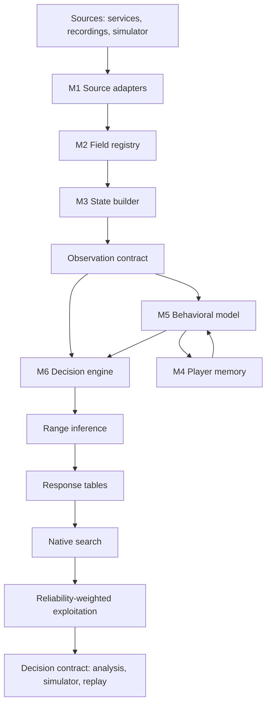
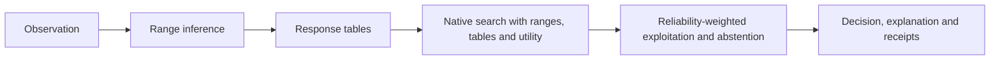
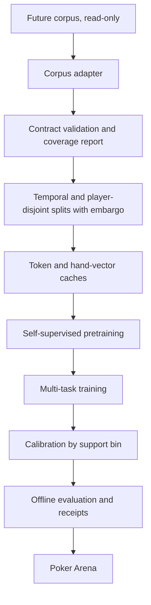

# Needle-1: Modular Player Modeling and Decision Architecture

*Architecture, mathematics and implementation plan*

**Document version:** 0.3, English edition, November 5, 2026.

**Builds on:** [Needle-0: Poker Player Encoder](../needle-0/MODEL.en.md).

**Current status:** Architecture specification. Needle-1 has not been
implemented or trained. The Needle-0 components, benchmark platform and
native decision engine referred to below exist in the private research
workspace.

**Revision 0.2:** a design review corrected range inference, the training of
hand-conditional behavior, the change signal, the memory decay, uncertainty
estimates, the promotion criteria and the safety claims, and added sections on
permitted use and production operations. See
[Changes in version 0.2](#changes-in-version-02).

**Revision 0.3:** a review of the collection database schema confirmed its
compatibility and added corpus requirements C1 to C8, cross-source ordering
of player history, censored decision times, a cap on any single player's
weight and the cost of hand-class training. See
[Changes in version 0.3](#changes-in-version-03).

### Abstract

Needle-1 is the successor of Needle-0. It keeps the idea of learning a
player's behavior from structured, causally ordered hand histories, and
adds what Needle-0 lacked to change decisions in practice.

Four modules are connected by versioned contracts. A **data contract**
describes every variable with its type, unit, availability time and
qualification state, so that the model can run on services that expose
different information. A **player memory** keeps a persistent long-term
profile built from the complete history and a short-term representation of
recent hands, combined according to the amount of evidence. A **behavioral
model** predicts actions, bet sizes, hand-conditional actions and, where
available, decision times, together with an estimate of its own uncertainty.
A **decision engine** turns those predictions into opponent ranges, response
tables and expected values, then weights exploitation by the reliability of
each profile.

The architecture covers cash games, multi-table tournaments, Sit & Go and
heads-up play, from two to nine players per table. It works with a small set
of fundamental fields and uses complementary fields, such as decision timers,
when a service provides them, without treating missing values as zeros.

**Keywords:** opponent modeling, player representation, imperfect
information, missing data, hierarchical shrinkage, Bayesian range inference,
safe exploitation, ICM, modular data contracts.

## Design and scope

Needle-1 must:

- predict each opponent's behavior from the complete observed history while
  remaining sensitive to recent changes.
- turn those predictions into decisions, while remaining cautious when a
  profile is supported by little evidence.
- run with the fundamental fields alone and use complementary fields when a
  service provides them.
- support cash games, MTTs, Sit & Go and heads-up play, from two to nine
  players.
- absorb changes in the fields of the future corpus without a redesign.

Needle-1 does not automate any action in a game client. It produces
predictions and analysis, and plays only in the local **Poker Arena**
simulator. Its permitted uses are defined in
[Permitted use and compliance](#permitted-use-and-compliance): offline
analysis, replay and simulation are in scope. Assistance during real-money
play is not. Corpus construction is a separate project. This
document defines only the input contract that the corpus must be able to
feed. Variants other than No-Limit Hold'em are representable in the contract,
but no model is specified for them.

The dimensions and thresholds below are starting values, not measured
optima. Requirement words follow a simple convention: **must** is mandatory,
**should** is recommended unless a documented reason applies, **may** is
optional.

### Non-functional requirements

| Requirement | Target | Rationale |
| --- | --- | --- |
| Prediction latency, one query on CPU | at most 10 ms at p95 | Needle-0 measured 5.3 ms on its full path |
| Full decision latency, analysis mode | at most 1,500 ms at p95 on a 4-core CPU | Interactive review of recorded or simulated decisions |
| Full decision latency, simulator | at most 3,000 ms at p95 | Campaign throughput |
| Determinism | Same input and seed give the same output | Replay and audit |
| Traceability | Every output is bound to code, weights, field registry and profile hashes | Extends the Needle-0 code receipt |
| Privacy | Identities, private cards, weights and profiles stay outside public repositories | Project rule |
| Degradation | A missing complementary field causes no error and no invented value | Multi-service requirement |

## Lessons from Needle-0

### What worked

| Component | Observation |
| --- | --- |
| Causal contract | No feature after the decision boundary, missing values kept distinct from zero, ordering by source position |
| Artifact discipline | Weights bound to the exact source code, safe loading, private artifacts |
| Training stack | Caching, micro-batches, GPU training, resumable runs, temperature calibration |
| Native engine | Exact and Monte Carlo equity, a heads-up decision tree and a bounded multi-player action search with intervals and abstention |
| Benchmark platform | Independent referee, replay, settlement oracle, paired seeds, block bootstrap, integrity audit |
| Cost | Network and tensor preparation took about 8 % of simulated decision time |

### What the measurements show

Results from the private workspace, not recomputed here:

- **Prediction.** On a 512-decision development panel, Needle-0 reached
  71.9 % accuracy and a log loss of 0.648. Masking the history gave 72.9 %
  and 0.653. The paired difference was not significant. Raise recall was
  16 %.
- **Model comparison.** The best network in the comparative study reached
  67.3 % on its selection set, against 66.7 % for a gradient-boosted tree
  model.
- **Simulated play.** In an interim Poker Arena snapshot of 7,585 completed
  sessions, Needle-0 and the native search without a neural predictor were
  statistically tied in heads-up cash at 20, 100 and 200 big blinds and in
  six-player cash. History on minus history off was not significant in any
  main panel. The only positive signal was an exploratory sub-panel against a
  strategy that changes over time.
- **Tournaments.** A synthetic strategy that folds very often had the best
  Sit & Go return, because the candidates optimized chips rather than prize
  equity.

Needle-0 therefore adds a reasonable predictive layer, but it does not change
decisions measurably. The main problem is where its predictions enter the
decision, not the quality of the network.

### Causes

| Area | Cause |
| --- | --- |
| Decision | Opponent ranges were uniform. Observed actions never narrowed the hands an opponent could hold. |
| Decision | Predictions did not depend on private cards, so they could not separate value bets from bluffs or feed range inference. |
| Decision | The network was queried once at the root. Later nodes of the search used fixed continuation rules. |
| Decision | The highest estimate was played even when action intervals overlapped. No reliability weighting existed. |
| Decision | Tournaments were evaluated in chips, without prize equity. |
| Model | The history was capped at ten hands for resource reasons, while the design targeted 64 and then 256. |
| Model | Hand positions were counted from the oldest kept hand and hand age was always zero, so recency had no stable meaning. |
| Model | No persistent profile existed. The amount of evidence entered only as two counters in the fusion layer. |
| Model | All features shared 4,096 hash buckets. |
| Model | No sizing head, no decision time and no tournament phase were used. |
| Data | Economic fields were withheld for most corpus examples, identities were local to each source and no hand was certified complete. |
| Benchmark | The reference population was easy to exploit, which hid differences between candidates. Seven to nine player tables were not covered. |

## Architecture overview



| Module | Responsibility |
| --- | --- |
| M1 Source adapters | One adapter per service or recording format. The only code that knows a source format. |
| M2 Field registry | Type, unit, tier, availability time and qualification of every variable. |
| M3 State builder | Table state at the decision boundary, derived quantities and consistency checks. |
| M4 Player memory | Long-term profile, short-term representation and reliability for each player. |
| M5 Behavioral model | Action, sizing, hand-conditional and timing predictions with uncertainty. |
| M6 Decision engine | Ranges, response tables, native search, exploitation weighting and utility. |

Design principles:

1. **One point of contact per source.** Nothing downstream reads a service
   format.
2. **Every field is declared.** The model consumes registered fields, plus an
   explicit hashed fallback for unregistered ones.
3. **Absence is not zero.** Every value carries a state.
4. **Versioned contracts** between modules. A module can be replaced as long
   as its contract is respected.
5. **The native engine stays a separate process** with no dependency on the
   neural network. Predictions reach it as tables.

| Mode | Inputs | Outputs | Constraints |
| --- | --- | --- | --- |
| Training | Corpus, read-only | Weights, receipts, metrics | Offline, GPU allowed |
| Simulator | Referee view restricted to the actor | Simulated action | Deterministic, paired seeds |
| Replay | Recorded hands | Predictions and hypothetical decisions | No future information |
| Analysis | Recorded hands, study positions or simulated games | Displayed analysis | Read-only, latency budget, never during real-money play |

## Data contract

### Canonical event stream

Each hand is an ordered sequence of events. Every event must carry:

| Field | Description |
| --- | --- |
| `event_id` | Stable identifier within the source |
| `source_position` | Causal order within the source, not a clock |
| `available_at` | When the information becomes observable |
| `hand_ref` | Table, hand and source |
| `kind` | `hand_start`, `seat_state`, `post`, `deal_board`, `action`, `showdown`, `payout`, `tournament_state`, `timer` or `info` |
| `actor_ref` | Player concerned, if any |
| `fields` | Values, each as a field value with a state |
| `provenance` | Source, adapter version and hash of the original |

Within one source, ordering always uses `source_position`, as in Needle-0.
Clock values can be features, for example hand age or a timer, but never
reorder events of the same source.

A player's history spans several tables and sources, whose positions are not
comparable. Across sources, hands are ordered by their observed end time,
with a declared clock uncertainty $\epsilon_{\mathrm{clock}}$ for each pair of
sources. The player memory used for a decision at time $t$ only contains hands
from other sources that ended before $t - \epsilon_{\mathrm{clock}}$. Hands
whose relative order is ambiguous within that margin are kept in end-time
order and flagged, and the short-term branch receives that flag.

### Source profiles

Every service, or service version, is described by a versioned profile that
declares, for each registered field, whether the source:

- `provided`: normally supplies it.
- `not_provided`: never supplies it, for example a service without timers.
- `conditional`: supplies it only in some situations, such as cards shown at
  showdown.

The profile lets the model distinguish "this service has no timer", which
carries no information, from "the timer is missing for this decision on a
service that normally has one", which may be a signal. The profile hash
travels with each observation.

### Field registry

One entry per variable:

```yaml
- name: action.decision_time
  tier: complementary            # fundamental | economy | complementary
  type: duration                 # categorical | numeric | amount | card | duration | ordinal | set
  unit: seconds
  normalization: log1p
  available_at: after_action     # before_notification | at_decision | after_action | after_hand
  feature_scope: past_actions    # never the decision being predicted
  target: true                   # auxiliary timing head
  formats: [cash, mtt, sng, hu]
  missing_semantics: unknown     # unknown | not_applicable
  qualification: timer_qualified_v1
  privacy: public
  since_registry_version: 1
```

Rules:

- Every field must declare `available_at`. The state builder refuses any
  field whose availability follows the decision boundary. This makes the
  Needle-0 causal contract declarative.
- A player's decision time is known only after the action. It can describe
  that player's earlier actions, including earlier actions in the same hand,
  and it can be an auxiliary target. It is never an input for the decision
  being predicted.
- Adding a field means adding a registry entry and incrementing the registry
  version. The tokenizer creates the corresponding embedding.
- A field is retired through a `deprecated` entry with a mapping, never by
  deletion.
- A corpus field that is not yet registered is encoded through the hashed
  fallback, marked `unregistered` and reported in the coverage report.

Every feature must satisfy

```math
\mathrm{availableAt}(f) \prec t,
```

where $t$ is the information boundary of the target decision and $\prec$ is
the source order.

### Units and derived quantities

| Quantity | Internal representation | Derived by the state builder |
| --- | --- | --- |
| Amounts: stacks, bets, pot, blinds, antes | Original integer chips plus current big blind | Big blinds, pot fraction, stack-to-pot ratio, effective stack |
| Tournament amounts | Chips | Big blinds, fraction of the average stack, fraction of chips in play |
| Tournament prizes | Buy-in units | Prize share per place |
| Durations | Seconds | log1p, ratio to the allotted time when known |
| Cards | Rank and suit | Hand classes, board texture |
| Positions | Physical seat, button, occupied seats | Seat relative to the button, position class |

A derived value inherits the least favorable state of its inputs. For
example, the stack-to-pot ratio is unknown when the pot is unknown.

## Fundamental, economic and complementary information

### Three tiers

| Tier | Role | When absent |
| --- | --- | --- |
| **T0 Fundamental** | Needed to represent the decision at all | The observation is refused |
| **T1 Economy** | Needed for expected values and strongly useful for prediction | Prediction runs in a degraded mode. The decision engine gives no numerical evaluation |
| **T2 Complementary** | Enriches predictions and decisions | No blocking effect. The model sees the absent state |

### T0: fundamental fields

| Field | Note |
| --- | --- |
| Variant and betting structure | No-Limit Hold'em for the specified model |
| Game format | Cash, MTT, Sit & Go, heads-up. Unknown is accepted and reported |
| Table capacity | 2 to 9. 10 is representable but not qualified |
| Occupied seats and button | Needed for positions |
| Actor seat | |
| Street and public board | |
| Current-hand action sequence: actor, action type, order | Amounts belong to T1 |
| Local player reference within the source | May have low identity confidence |

### T1: economy of the decision

| Field | Note |
| --- | --- |
| Small blind, big blind, ante amount and type, straddle | Ante is not applicable in a cash game without antes |
| Stacks at hand start | |
| Contributions per street and action amounts | |
| Pot before the action, side pots and eligibility | Derivable when the components are qualified |
| Amount to call, minimum raise, raise rights | Derivable. Legal actions when supplied |
| Cash rake rate and cap | Used in expected values. Unknown otherwise |

### T2: complementary fields

| Field | Use |
| --- | --- |
| Decision time of earlier actions, allotted time, time bank | Feature of earlier actions, auxiliary target |
| Cards shown at showdown | Hand-conditional head, profile updates |
| Net result of the player's earlier hands | Recent trend, tilt indicators |
| Tournament structure: level, level duration, players remaining, entrants, paid places, final table, late registration | Phase and prize pressure |
| Payout table | Prize equity |
| Bounties and current bounty per player | Bounty utility |
| Cash variant: regular or fast-fold | Context and priors |
| Absolute hand timestamps, session breaks | Hand age and sessions |
| Sitting-out and reconnection state | Context |

### Declared output mode

Every Needle-1 output declares a mode:

- `full`: T0 and T1 are qualified.
- `prediction_only`: T1 is incomplete, so only behavioral predictions are
  produced.
- `refused`: T0 is incomplete and nothing is produced.

It also lists the T2 field groups actually used.

## Missing, incomplete and unqualified values

### Field states

Every value passed to the model is a pair of a value and a state.

| State | Meaning | Value |
| --- | --- | --- |
| `observed` | Present and qualified | Value |
| `derived` | Computed from observed values by a versioned formula | Value |
| `censored` | Only a bound is known, such as a decision time when the timer expired or the player disconnected | Lower bound |
| `unqualified` | Present, but its unit, timing or attribution is not guaranteed | Kept for audit, not given to the model |
| `withheld` | Exists but becomes available after the decision boundary | Not given to the model |
| `missing` | Expected by the source profile but absent here | None |
| `not_provided` | The source profile never supplies this field | None |
| `not_applicable` | Meaningless in this format, such as an ante in a cash game without antes | None |

Rules:

- No imputation in the inputs. The state builder never replaces an absent
  value with zero, a mean or an estimate.
- An estimate may exist as a **separate registered field** with a `derived`
  state and explicit provenance, never in place of the observed field.
- An `unqualified` value is kept for audit and coverage reports, and treated
  as absent by the model.

### Representation in the model

For field $f$ with state $\sigma_f$ and value $v_f$, the tokenizer produces

```math
e_f = E^{\mathrm{state}}(\sigma_f) + \mathbb{1}\left[\sigma_f \in \mathcal{O}\right] \, E^{\mathrm{value}}_f(v_f),
\qquad
\mathcal{O} = \lbrace \mathrm{observed}, \mathrm{derived}, \mathrm{censored} \rbrace .
```

The state embedding is always present, and the value embedding only when the
value is usable. For a `censored` value, the value embedding encodes the
bound and the state embedding tells the model that the true value is at least
that large. This is an explicit missing-indicator representation, which
is better behaved than silent imputation
([Van Ness et al., 2023](https://arxiv.org/abs/2211.09259)).

The model also receives the aggregated **capability mask** of the source
profile. It can learn that a `not_provided` timer carries no information,
while a `missing` timer on a service that provides timers may.

### Robustness through modality dropout

To keep the model strong without complementary fields:

- each T2 group, such as timing, recent results, detailed tournament state or
  shown cards, is replaced by `not_provided` during training with probability
  $p_g$ between 0.3 and 0.5, following
  [ModDrop (Neverova et al., 2016)](https://arxiv.org/abs/1501.00102).
- T1 groups are dropped with a lower probability, around 0.1, to keep the
  `prediction_only` mode usable.
- examples from services without timers are left as they are.

### Verifiable guarantees

| Guarantee | Test |
| --- | --- |
| T0 and T1 alone perform at least as well as a model trained without T2 | Evaluation with every T2 group forced to `not_provided` |
| Adding a T2 group never degrades predictions | Paired evaluation with and without the group |
| No invented value | State-builder unit tests: every absent input produces a state, never a value |
| No temporal leakage | Contract tests on `available_at` |
| Service change without retraining | Evaluation on a source with a different profile |

## Game formats

### Format context

The state builder computes a format context for every decision.

| Field | Values |
| --- | --- |
| `game_format` | `cash`, `mtt`, `sng`, `hu`, with the heads-up family recorded as cash or Sit & Go |
| `cash_kind` | regular, fast-fold, unknown |
| `table_capacity` | 2 to 9 |
| `seated_players`, `active_players` | Seated players and players still in the hand |
| `position_class` | Appendix A, depends on the number of seated players |
| `effective_stack_bb`, `spr` | T1 |
| `ante_kind` | none, per player, big-blind ante, unknown |
| `tournament_phase` | early, middle, bubble, final, unknown |
| `tournament_pressure` | Players remaining relative to paid places, share of chips in play, level |
| `payout_kind` | none, flat, pyramidal, winner-take-all, bounty |

The tournament phase reuses the existing four-phase rule of the private
workspace: early while late registration is open, final when the remaining
players fit at one table, bubble when the remaining players are within one
table of the paid places, and middle otherwise. An unknown number of paid
places leaves the phase unknown instead of guessing.

### Strategic differences and architectural responses

| Difference | Response |
| --- | --- |
| Two to nine players | Seats relative to the button, a position class for each table size, attention over a variable number of seat tokens, and a native search that already supports two to nine players |
| Heads-up rules | The button posts the small blind, acts first before the flop and last afterwards. The state builder and referee encode this rule. It is not learned. |
| Stack depth | Effective stack and stack-to-pot ratio as inputs, depth bins for calibration and priors |
| Blinds and antes | Amounts in big blinds, explicit ante type, derived starting pot |
| Cash versus tournaments | One shared network conditioned on the format context with FiLM, rather than separate models |
| Prize structure | Utility function of the decision engine: chips in cash, prize equity in tournaments |
| Tournament phases | Phase and pressure features, and an ICM utility that depends on players remaining |
| Sit & Go versus MTT | A Sit & Go has one table and known payouts, so exact ICM is possible. An MTT field is only partly observed, so ICM is approximated. |
| Fast-fold cash | Short-term history is built per player, not per table |

FiLM ([Perez et al., 2018](https://arxiv.org/abs/1709.07871)) modulates a
hidden vector $g$ with a scale and a shift computed from the format context
$\phi$:

```math
\tilde g = \gamma(\phi) \odot g + \beta(\phi).
```

Sharing one network lets rare formats benefit from common poker knowledge,
while FiLM lets each format change how that knowledge is used.

### Player profiles by format family

A player does not necessarily play the same way in cash games and
tournaments. Long-term memory is stored per player and per format family,
`cash` or `tournament`, with a global player profile as a fallback.
Heads-up is treated as context rather than as a separate family, because a
separate family would have too few observations.

### Balanced data across formats

- Training uses stratified sampling by format, number of players and depth
  bin, so that a dominant format does not overwhelm the others. The Needle-0
  corpus covered only six to nine-seat tables.
- Metrics and calibration are reported for each format, player-count and
  depth cell. A cell below the support threshold is reported as having
  insufficient support.

### Native-engine limits to remove

| Current limit | Effect | Work item |
| --- | --- | --- |
| Pre-existing side pots with unequal eligibility are not supported | Conservative fallback in the simulator | Multi-pot search |
| Chip expected value only. ICM and bounties disabled | Poor tournament decisions | ICM and bounty utility |
| Rake fixed at zero | Overstated cash expected values | Rake parameter |
| Uniform ranges in current use, although weighted ranges are already accepted | Information from actions is lost | Range inference |

## Behavioral model

### Prediction task

Let $j$ be the observed player, $x_t$ the observation at boundary $t$ and
$\mathcal{M}_j^t$ the player memory available strictly before $t$. With
action $a_t$ and sizing class $s_t$, the behavioral model approximates

```math
q(a_t, s_t \mid x_t, \mathcal{M}_j^t)
= q(a_t \mid x_t, \mathcal{M}_j^t) \, q(s_t \mid a_t, x_t, \mathcal{M}_j^t).
```

The sizing distribution is used for bets and raises.

### Typed tokenizer

- One token per event of the hand and one current-state token, as in
  Needle-0.
- Each token is the sum of its field embeddings, an event-type embedding and
  a relative-seat embedding.

| Field type | Encoding |
| --- | --- |
| Categorical | Embedding table with an unknown entry |
| Numeric, amount or duration | Registry normalization, then a linear projection, as in [FT-Transformer (Gorishniy et al., 2021)](https://arxiv.org/abs/2106.11959). Clipping at four standard deviations is kept from Needle-0 |
| Card | Rank embedding plus suit embedding |
| Set, such as legal actions | Sum of element embeddings |
| State | State embedding, always present |

Normalization statistics are fitted on training data only, then frozen and
versioned with the registry.

Unregistered fields use the Needle-0 hashed `EmbeddingBag` with 4,096
buckets and an `unregistered` marker. This path absorbs a new field before it
is declared. It must not carry T0 or T1 fields.

### Encoders

| Encoder | Design | Origin |
| --- | --- | --- |
| Hand, past or current | Pre-norm Transformer, GELU, two layers, summary token | Needle-0, with typed inputs |
| Current hand | Same encoder with a causal mask | Needle-0 |
| Table seats | Attention over a variable number of seat tokens | New |
| Player memory | See the next section | New |

Starting dimensions: model width 256, profile width 128, eight heads and a
feed-forward width of 1,024, as in Needle-0. A width-128 variant is also
evaluated, because the smaller Needle-0 network was better on its
selection set. The final choice is made on the new corpus.

### Output heads

| Head | Output | Active when |
| --- | --- | --- |
| Hand-conditional action | Action distribution given a hand class | Always, trained on every decision (see below) |
| Hand-conditional sizing | Pot-fraction classes given a hand class: up to 0.33, 0.33 to 0.66, 0.66 to 1.0, 1.0 to 1.5, above 1.5, all-in | Qualified T1 amounts |
| Direct action | fold, check, call, bet, raise, without a hand | Cold start and diagnostics only |
| Decision time | Distribution over log-time bins | Qualified timer in the source |
| Future style statistics, training only | VPIP, PFR, aggression, continuation-bet frequency over the player's next hands within the same split period | Training |

**Hand classes.** Before the flop, the 169 canonical starting-hand classes.
After the flop, made-hand category combined with draws, or the equity decile
against a uniform range computed by the native equity engine.

### Decision-time head with censoring

The timing head predicts a distribution over log-time bins $k$, with
probabilities $p_k$. A duration observed in bin $k_i$ contributes
$-\log p_{k_i}$. A censored duration only says that the decision took at
least as long as its bound, which falls in bin $k_i$, so it contributes the
survival term

```math
\ell_i^{\mathrm{time}} = - \log \sum_{k \ge k_i} p_k .
```

Treating a timeout as an observed duration would teach the model that long
decisions stop at the time limit. The source's timing quality label is kept as
a field state, and low-quality timings are excluded from the timing target.

### Learning hand-conditional behavior

Training the hand-conditional head only on hands shown at showdown would be
biased in a way that no reweighting on the decision context can fix. A hand
reaches showdown only if the player did not fold along the way, and that
selection depends on the hidden cards themselves. Shown hands therefore
under-represent folds and weak holdings. The learned benchmark opponent of
Needle-0 failed its qualification for this reason: its shown-hand sample
contained no folds.

Needle-1 instead trains on **every** decision and treats unseen cards as a
latent variable. Let $b_i$ be the observer's belief over the actor's private
combinations at decision $i$, computed from earlier actions of the same hand
by the range filter described in the decision engine. For a decision whose
cards were not revealed, the loss is the negative marginal log-likelihood

```math
\ell_i = - \log \sum_{c} b_i(c) \, q\left( a_i, s_i \mid x_i, \mathrm{class}(c), \mathcal{M}_j^i \right).
```

When the cards $c_i$ were revealed later in the hand, the decision also
contributes the direct term $-\log q(a_i, s_i \mid x_i, \mathrm{class}(c_i), \mathcal{M}_j^i)$.
Training alternates between computing beliefs with the current model
(without gradients) and updating the model, which is an
expectation-maximization scheme
([Dempster, Laird and Rubin, 1977](https://doi.org/10.1111/j.2517-6161.1977.tb01600.x))
applied to hidden cards, in the spirit of
[Southey et al. (2005)](https://arxiv.org/abs/1207.1411). It is initialized on
revealed hands and preflop all-in hands, and native equity features make the
classes comparable across boards.

### One coherent action distribution

The decision engine and every published prediction use a single action
distribution: the hand-conditional head averaged over the current belief,

```math
q(a_t \mid x_t, \mathcal{M}_j^t) = \sum_{c} b_t(c) \, q\left( a_t \mid x_t, \mathrm{class}(c), \mathcal{M}_j^t \right).
```

The direct action head is kept only for cold-start diagnostics and as a
baseline. A consistency term keeps it aligned with the marginal, so the two
can never tell different stories about the same decision:

```math
\mathcal{L}_{\mathrm{consistency}} = \mathrm{KL}\left( q_{\mathrm{direct}} \,\Vert\, q \right).
```

### Fusion

The fusion block receives the current-hand state $c_t$, the shrunk long-term
profile $\hat L_j$, the short-term representation $S_j$, the change signal
$\Delta_j$, the reliability vector $r_j$ and the capability mask $\mu$:

```math
h_t = \mathrm{MLP}\left( \left[ c_t , \hat L_j , S_j , \Delta_j , r_j , \mu \right] \right),
```

with two layers, and FiLM conditioning from the format context. Needle-0
used a single layer.

### Uncertainty

- **Ensemble.** Three independently trained models, with different seeds
  and data order. Their mean is the prediction and their dispersion is the
  epistemic uncertainty
  ([Lakshminarayanan et al., 2017](https://arxiv.org/abs/1612.01474)). Heads
  sharing one trunk would be cheaper but underestimate uncertainty, so they
  are only an option if a validation shows comparable dispersion quality.
- **Calibrated dispersion.** The raw dispersion is mapped to an observed
  error rate on the calibration set before it is used as a reliability input,
  so that a small dispersion actually means a reliable prediction.
- **Calibration.** Temperature scaling by support bin, with logits
  $\ell_a$ and temperature $T_b$ for bin $b$:

```math
q_{T_b}(a) = \mathrm{softmax}\left( \frac{\ell_a}{T_b} \right).
```

- **Output.** Mean distribution, dispersion and reliability bin.

## Player memory and temporal representation

### Goal

Use the complete history instead of ten hands, respect chronology,
distinguish a durable style from a recent trend and weight the profile by the
amount of evidence.

### Hand vectors

Each observed past hand of player $j$ is encoded once by the hand encoder into
a vector $h_{j,k}$, stored with its context (format, depth and phase) and its
timestamp.

### Long-term profile

The persistent state of player $j$ in format family $f$ contains an
accumulator $A_j$, a weight $W_j$, a hand count $n_j$, decision counts by
decision family and street, the last-seen time, the hash of the checkpoint
that produced the hand vectors, and an identity confidence.

The profile is updated once per observed hand of the player. With a decay per
player hand $\gamma$ and an optional decay per elapsed time $\gamma_{\mathrm{time}}$
over the time $\Delta t$ since the player's previous hand:

```math
\lambda = \gamma \, \gamma_{\mathrm{time}}^{\Delta t},
\qquad
A_j \leftarrow \lambda A_j + h,
\qquad
W_j \leftarrow \lambda W_j + 1,
\qquad
L_j = \frac{A_j}{W_j},
\qquad
\gamma = 2^{-1/\tau}.
```

The half-life $\tau$, for example 2,000 of the player's hands, and the time
half-life are validated hyperparameters. Setting both decays to one gives a
simple mean. The update costs the same for the first and the ten-thousandth
hand.

The same state also keeps a **fast mean** $F_j$ of the same hand vectors,
updated identically with a short half-life, for example 20 hands. Because
$L_j$ and $F_j$ live in the same vector space, their difference is a
meaningful change signal.

Hand vectors depend on the weights. A new checkpoint must recompute stored
profiles from stored hands, which is why the checkpoint hash is part of the
state.

### Short-term representation

- The last $K$ hands of the player, $K = 32$ initially, in order.
- Positions are counted **from the most recent hand**, which fixes the
  Needle-0 convention.
- Each hand receives its real age: hands elapsed, elapsed time encoded with
  [Time2Vec (Kazemi et al., 2019)](https://arxiv.org/abs/1907.05321), and a
  session-break indicator.
- Each hand keeps its context, so that a change of format or depth is not
  mistaken for a change of behavior.
- The player's net result in each hand is added when it can be attributed.
- A two-layer Transformer with a summary token produces $S_j$, of width 128.

### Shrinkage and reliability

A learned population profile is the prior. It depends on the format family
$f$ and on the source and stake level $s$, with hierarchical back-off to the
format family when a source or stake level has too little data:

```math
\mu_{f,s} = \mu_f + w(n_{f,s})\,\left( \bar\mu_{f,s} - \mu_f \right).
```

The population observed by the collection is not necessarily the population
of the service or stake level being analyzed, so a single global prior would
be biased. The drift of each population profile is monitored (see Production
operations).

The long-term profile moves away from its prior as evidence accumulates:

```math
\hat L_j = \mu_{f,s} + w(n_j)\,\left( L_j - \mu_{f,s} \right),
\qquad
w(n) = \frac{n}{n + \kappa},
\qquad
\kappa \gt 0 \ \text{learned}.
```

This is the principle of hierarchical Bayesian opponent models
([Southey et al., 2005](https://arxiv.org/abs/1207.1411)) and of the P6
player effect with a Gaussian prior in the private workspace. A separate
shrinkage weight is learned for each decision family, using
$n_j^{\mathrm{dec}}$, because rare situations such as river raises need more
evidence than frequent ones.

The change signal compares the fast and slow means of the same hand vectors.
The short-term Transformer output $S_j$ remains a separate input. It is not
subtracted from $\hat L_j$ because the two vectors do not live in the same
space.

```math
\Delta_j = F_j - \hat L_j,
\qquad
r_j = \left[ \log(1+n_j), \ \log(1+n_j^{\mathrm{dec}}), \ \log(1+K_j), \ c_j^{\mathrm{id}}, \ \lVert \Delta_j \rVert, \ u_j \right],
```

where $n_j^{\mathrm{dec}}$ counts decisions of the current decision family,
$K_j$ is the number of recent hands actually encoded, $c_j^{\mathrm{id}}$ is
the identity confidence and $u_j$ is the calibrated ensemble dispersion.

A large $\lVert \Delta_j \rVert$ indicates that recent behavior departs from
the player's usual style. An online change-point probability
([Adams and MacKay, 2007](https://arxiv.org/abs/0710.3742)) may be added to
$r_j$ if measurements show a benefit.

### Identity

- Long-term memory is updated only for identities whose linking confidence
  exceeds a declared threshold. The collection database records network
  players under keys scoped to one collection epoch, so the long-term profile
  depends on the identity resolution of requirement C1 and on decision D1.
- A low-confidence identity receives session memory only: a short-term
  representation without a long-term profile.
- Identity confidence is part of $r_j$.

### Giving profiles a meaning

Without a dedicated objective, the Needle-0 player representation learned
little. Two training objectives are added.

**Identity contrast.** Two disjoint history slices of the same player should
produce close profiles, and slices of different players distant ones. With a
similarity function $\mathrm{sim}$, temperature $\eta$ and a batch of $B$
players ([van den Oord et al., 2018](https://arxiv.org/abs/1807.03748)):

```math
\mathcal{L}_{\mathrm{id}} = - \frac{1}{B} \sum_{j=1}^{B}
\log \frac{\exp\left( \mathrm{sim}(L_j^{(1)}, L_j^{(2)}) / \eta \right)}
{\sum_{m=1}^{B} \exp\left( \mathrm{sim}(L_j^{(1)}, L_m^{(2)}) / \eta \right)} .
```

Two slices of the same player often share a table, a session and a stake
level. Without precautions, the profile could learn that context instead of a
style. The two positive slices are therefore taken from **different
sessions**, and negatives are drawn preferentially from other players seen
at the same table, session or stake level. The table, session and stake
context of each slice is also given to a small adversarial classifier whose
success is reported. A profile that predicts the context much better than the
style is rejected.

**Future style statistics.** The profile also predicts the player's style
statistics over later hands, which gives an interpretable anchor and a
quality check. These targets are computed only from hands inside the same
split period as the example, with the same embargo as the splits. A target
must never use hands from a later validation or test period.

## Decision engine

### Decision chain



### Range inference

For each active opponent, a belief $b_t$ over the 1,326 private-card
combinations is filtered by known cards. It starts from the **deal
distribution**: uniform over the combinations that are not blocked by known
cards. Position, format, profile and every action, including preflop
actions, enter only through the likelihood. A prior that already depended on
the preflop action would count that action twice and make ranges too narrow.
The belief is updated after each observed action $a_\tau$ with size
$s_\tau$:

```math
b_\tau(c) \propto b_{\tau-1}(c) \, q\left( a_\tau, s_\tau \mid x_\tau, \mathrm{class}(c), \mathcal{M}_j^\tau \right),
```

then smoothed so that no hand is excluded by mistake:

```math
\tilde b_\tau = (1 - \epsilon)\, b_\tau + \epsilon \, U,
\qquad \epsilon \approx 0.02 ,
```

where $U$ is the uniform distribution over the remaining combinations. The
likelihood comes from the hand-conditional head. The native engine already
accepts weighted ranges of up to 1,326 combinations per opponent. If T1 is
missing, the likelihood uses the action alone. If the hand-conditional head
fails its validation, the engine falls back to a population hand-conditional
model without the individual profile, and declares that mode.

The same filter supplies the beliefs used to train the hand-conditional head.
Beliefs computed during training never use cards revealed later in the hand
for decisions that precede the reveal.

### Response tables

The native engine must not call the network. Before the search, the decision
engine computes batched predictions over a grid of hypothetical nodes:

| Table key | Values |
| --- | --- |
| Opponent | Active seats |
| Street | Current and later streets |
| Situation | Facing a bet or not |
| Size faced | Sizing classes |
| Hand class | Postflop hand classes |

Each cell holds a response distribution over fold, call and raise, or check
and bet, plus raise sizes. The heads-up decision tree already accepts
response policies with `default`, `by_combo` and `by_sizing` entries. The
multi-player search must be extended to read the same structure at every
node. A typical grid needs a few hundred batched queries, which fits the
measured prediction cost.

### Extended native search

The existing bounded multi-player search simulates play to the river for two
to nine players, reports intervals and abstains when actions are not
separated. Needle-1 adds:

1. weighted ranges for each opponent.
2. per-node response tables instead of fixed root marginals.
3. several leaf continuations (predicted, more aggressive and more passive),
   following [Pluribus (Brown and Sandholm, 2019)](https://doi.org/10.1126/science.aay2400),
   combined by a reliability-weighted mean or by their minimum in a robust
   mode.
4. side pots with unequal eligibility.
5. a configurable utility and a rake model: rate, cap and the no-flop,
   no-drop rule when the source declares it.
6. a model of the hero's own later decisions. The current search plays the
   hero's future actions with a simple card-strength score, which biases
   every expected value. Needle-1 replaces it with the population
   hand-conditional model applied to the hero's own cards, and may re-run a
   shallow search at the next street. An ablation compares both.

### Reliability-weighted exploitation

Two evaluations are computed for each candidate action $a$:

- $\mathrm{EV}_0(a)$, under the population profile $\mu_{f,s}$ only. This
  reference plays the role of the current native baseline.
- $\mathrm{EV}_{\mathrm{exp}}(a)$, under the individual profile.

They are combined with an exploitation weight $\rho_j$:

```math
\mathrm{EV}_{\mathrm{mix}}(a) = (1 - \rho_j)\, \mathrm{EV}_0(a) + \rho_j \, \mathrm{EV}_{\mathrm{exp}}(a),
\qquad
\rho_j = \rho_{\max} \, \sigma\left( \beta^{\top} r_j \right).
```

The weight grows with the evidence and falls with ensemble dispersion and
low identity confidence. It is inspired by data-biased responses
([Johanson and Bowling, 2009](https://proceedings.mlr.press/v5/johanson09a.html))
and safe opponent exploitation
([Ganzfried and Sandholm, 2015](https://dl.acm.org/doi/10.1145/2716322)).
Interpolating expected values of a single decision is an approximation of
those methods, not an implementation of them.

**Guardrail.** With $a_0$ the best action under the population profile, an
exploitative action $a^{\ast}$ is kept only if

```math
\mathrm{EV}_0(a^{\ast}) \ge \mathrm{EV}_0(a_0) - \delta ,
```

for a declared tolerance $\delta$ in big blinds or prize equity.

This rule limits the loss **relative to the population model**. It is not a
game-theoretic safety guarantee: the population model is not an equilibrium,
so a strong adaptive opponent may still exploit Needle-1. Actual
vulnerability is measured separately by local best response (criterion S4)
and must be reported with every release.

**Abstention.** When the intervals of the best actions overlap, analysis
outputs publish the reference action with a `not_separated` status, as the
existing decision service does. The simulator may use a declared argmax mode for
evaluation.

### Utility by format

| Format | Terminal utility | Method |
| --- | --- | --- |
| Cash | Net chips minus rake | Exact |
| Sit & Go | Prize equity of stacks | Exact Malmuth-Harville, up to nine players |
| MTT final table | Prize equity | Malmuth-Harville on remaining players |
| MTT before the final table | Approximate prize equity | ICM over the table stacks plus a model of the rest of the field, by average stack or Monte Carlo samples. Close to chips far from the paid places |
| Bounty formats | Prize equity plus capturable bounties | Uses the current bounty when available. Otherwise ICM only, with a declared mode |
| Heads-up | Chips in cash, trivial ICM in a final | |

The Malmuth-Harville model gives player $i$ with stack $x_i$ the probability
of finishing first

```math
P_1(i) = \frac{x_i}{\sum_{k} x_k},
```

and computes later places recursively by removing the winner and
renormalizing over the remaining stacks. The prize equity of player $i$ is
the sum over places of the probability of that place times its prize. Exact
computation is practical for one table with dynamic programming over subsets
of players.

When the payout table is unknown in a tournament, the engine uses chips and
declares a `chip_ev_fallback` mode.

### Later: a learned policy

A learned policy may be added after the components above are validated, for
example reinforcement learning combined with search in the style of
[ReBeL (Brown et al., 2020)](https://arxiv.org/abs/2007.13544), trained in the
simulator against a diversified population and initialized from the native
search. It is outside the scope of version 1.0.

## Uncertainty and sparse histories

### Sources of uncertainty

| Source | Measure | Where it acts |
| --- | --- | --- |
| Player randomization | Predicted distribution | Response probabilities in the search |
| Model uncertainty | Ensemble dispersion | Exploitation weight |
| Amount of history | Hand and decision counts | Shrinkage and exploitation weight |
| Identity | Identity confidence | Long-term memory and exploitation weight |
| Missing data | Field states and output mode | Output mode and exploitation weight |
| Simulation | Search intervals | Abstention |

### Behavior by amount of evidence

| Observed hands | Profile used | Exploitation |
| --- | --- | --- |
| 0 | Population profile conditioned on format, position, depth and phase | None |
| 1 to 9 | Population profile with a small deviation. Short-term signal weak | Low |
| 10 to 49 | Partial long-term profile. Useful short-term signal | Moderate |
| 50 to 255 | Substantial long-term profile | High |
| 256 or more | Close to the individual profile | Maximum |

These bins are indicative. The exploitation weight is a continuous function,
not a lookup table.

### Calibration by support

- Support bins: 0, 1 to 9, 10 to 49, 50 to 255, and 256 or more hands,
  crossed with format.
- A separate temperature is fitted for a bin when its expected calibration
  error exceeds a declared threshold. Otherwise a shared temperature is used.
- Log loss, Brier score, calibration error and per-class recall are always
  reported by bin.

### Training across all history lengths

For each training example, the amount of history supplied is drawn between
zero and the available length, with more weight on small values, and
independently for long-term and short-term memory. Every level of knowledge
is therefore represented during training.

## Component interfaces

All contracts are JSON or an equivalent binary encoding. Each carries a
`contract` field and is refused when its version is unknown.

| Contract | Producer to consumer | Content |
| --- | --- | --- |
| `needle1-event-stream-v1` | Adapter to registry and state builder | Ordered events with states and provenance |
| `needle1-source-profile-v1` | Adapter to model | Field capabilities of a service |
| `needle1-observation-v1` | State builder to model and engine | Decision state, format context, field states, output mode |
| `needle1-player-memory-v1` | Memory to model | Long-term state, recent hands, reliability, checkpoint hash |
| `needle1-prediction-v1` | Model to engine | Distributions, dispersion, support, calibration, mode |
| `needle1-belief-v1` | Range inference to search | Weighted ranges, smoothing, number of updates, status |
| `needle1-response-table-v1` | Response tables to search | Per-node response policies |
| `needle1-decision-v1` | Engine to analysis, simulator or replay | Action, amount, expected values, intervals, weight, status, receipts |

Observation example:

```json
{
  "contract": "needle1-observation-v1",
  "registry_version": 1,
  "source_profile_sha256": "…",
  "mode": "full",
  "format": {"game_format": "mtt", "table_capacity": 9, "seated_players": 7,
             "tournament_phase": {"state": "observed", "value": "bubble"}},
  "actor": {"seat": 3, "player_ref": "p:…", "identity_confidence": 0.98},
  "seats": [{"seat": 0, "position_class": "BTN",
             "stack": {"state": "observed", "value": 41250},
             "committed": {"state": "observed", "value": 0}}],
  "economy": {"big_blind": {"state": "observed", "value": 1000},
              "ante": {"state": "observed", "value": 125, "kind": "per_player"},
              "pot": {"state": "derived", "value": 4375},
              "to_call": {"state": "derived", "value": 2000}},
  "board": [],
  "current_hand": [{"kind": "action", "seat": 1, "action": "raise",
                    "amount": {"state": "observed", "value": 2000},
                    "decision_time": {"state": "not_provided"}}],
  "complementary_used": []
}
```

Prediction example:

```json
{
  "contract": "needle1-prediction-v1",
  "model_sha256": "…",
  "player_ref": "p:…",
  "format_family": "tournament",
  "action": {"fold": 0.41, "check": 0.0, "call": 0.37, "bet": 0.0, "raise": 0.22},
  "action_dispersion": {"fold": 0.03, "call": 0.04, "raise": 0.02},
  "sizing": {"available": true, "classes": {"0.66-1.0": 0.6, "allin": 0.4}},
  "support": {"n_hands": 37, "k_recent": 32, "bin": "10-49", "identity_confidence": 0.98},
  "calibration": {"bin": "10-49|tournament", "status": "calibrated"},
  "mode": "full",
  "complementary_used": ["recent_results"]
}
```

The search request extends the existing multi-player search request with
weighted opponent ranges, response tables, leaf continuations, multiple pots,
a utility (`chip_ev`, `icm` or `icm_bounty`) with payouts, and rake. Every
decision record carries `"automation": false`.

## Training pipeline



### Corpus adapter

- The only component that reads the structure of the database being built.
- It produces the event stream and one source profile per service.
- It publishes a coverage report: for each registered field, the share of
  examples in each state, by format and source.
- Contract tests check that no field follows the decision boundary, that
  amounts are consistent (contributions sum to the pot when all are observed)
  and that positions are valid for the number of players.
- **Source profiles are validated against the data.** A field declared
  `provided` whose missing rate exceeds a declared threshold, or a field
  declared `not_provided` that appears, raises an alert and blocks the
  profile version. Otherwise the model would confuse "never supplied" with
  "missing", which is exactly the distinction it relies on.

### Collection database requirements

The future corpus is built from the shared collection database of the
private workspace. A review of its schema found it compatible with this
specification: it already records event order, source occurrences, proof
levels, decoder versions, hand revisions and completeness, seats and stacks,
revealed cards, pots, eligibility and awards, legal options, decision timing
with censoring and quality, per-hand metric contributions, and typed facts
for the decision economy, blinds, tournament phase and timers. The corpus
adapter must nevertheless satisfy the following requirements.

| Id | Requirement | Reason |
| --- | --- | --- |
| C1 | **Identity resolution.** Player keys recorded from the network are scoped to one collection epoch and are deliberately not global accounts. The adapter links those scoped keys into linked identities, for example by exact screen name on the same site through the alias records, and gives every link a confidence below one. | Without it, the long-term profile only accumulates within one epoch |
| C2 | **Hand deduplication.** A physical hand observed by several collectors can appear under several table and hand keys. Hands are deduplicated by site and full wire hand identifier before training and before profile updates. | Duplicates would double-count evidence in memory and training |
| C3 | **Revision pinning.** Hands can be re-decoded into new revisions. Every corpus snapshot records the hand, revision and decoder version it uses, and a changed revision triggers recomputation of the affected profiles. | Reproducibility and profile consistency |
| C4 | **Storage decoder.** Event payloads are stored compressed behind a virtual column that only the project's storage layer can decode. The adapter reads them through that layer and exports an explicit training format. | A plain SQLite or dataframe reader cannot read the payloads |
| C5 | **Frozen snapshot.** Training and evaluation read a consistent copy of the database, never the shared database that collectors are writing. | A long read on the live database holds its write-ahead log and slows collection |
| C6 | **Proof-level mapping.** A versioned table maps every proof level and decoder version to a field state of this specification. | The model relies on the state, not on source-specific labels |
| C7 | **Tournament subtype.** Tournament records often carry a tournament identifier without a qualified subtype. "Tournament, subtype unknown" is a valid format value, and Sit & Go or MTT treatment applies only when the subtype is qualified. | Avoids inventing a format |
| C8 | **As-of statistics only.** Cumulative player and session totals have no date and would leak the future. Only per-hand contributions, aggregated as of each example, may become features. | Temporal leakage |

### Splits

- **Temporal:** training precedes validation, which precedes test, with an
  embargo at each boundary.
- **Player-disjoint:** a test set of players never seen in training, which
  measures cold-start generalization.
- Recording or session groups define bootstrap clusters, as in Needle-0.

### Objectives

| Phase | Objectives | Data |
| --- | --- | --- |
| Pretraining | Next action of **every** player, not only one focal player, and masked event modeling | All hands, including incomplete ones |
| Multi-task | Hand-conditional action and sizing with latent hands, direct action with consistency, timing, future style, identity contrast | Examples qualified for each head |
| Calibration | Temperatures by support bin | Dedicated calibration set |

Each head is computed only on examples whose target is observed. With head
weights $\lambda_h$ and target masks $m_{i,h}$:

```math
\mathcal{L} = \sum_{h} \lambda_h \,
\frac{\sum_{i} m_{i,h} \, \ell_h(i)}{\max\left(1, \sum_{i} m_{i,h}\right)}
+ \lambda_{\mathrm{id}} \, \mathcal{L}_{\mathrm{id}}
+ \lambda_{\mathrm{c}} \, \mathcal{L}_{\mathrm{consistency}} .
```

For the hand-conditional heads, $\ell_h(i)$ is the latent-hand loss defined in
the behavioral model, so every decision has an observed target even when the
cards stay hidden.

### Sampling

- Stratification by format, number of players and depth.
- Random history length.
- Modality dropout for T2 and, less often, T1 groups.
- **Capped weight per player.** The local player's own hands always include
  their private cards, so they are an abundant source of hand-conditional
  supervision for a single style. Each player's share of the hand-conditional
  loss is capped, for example at 5 % of a training epoch, and the local
  player is reported as a separate evaluation slice.

### Infrastructure

The existing training stack is reused: caching, micro-batches, GPU training,
resumable runs and receipts. During training, the long-term profile is
computed on a bounded sample of past hands, for example 256. In production it
uses the full history. A weighted mean remains consistent between both when
the half-life is shorter than the training window, which a dedicated test
must verify.

The latent-hand loss evaluates the hand-conditional head once per hand class
rather than once per private combination: 169 classes before the flop and a
few dozen after it, with belief mass aggregated by class. Even so, it
multiplies the cost of the behavioral forward pass by that number of classes.
The compute budget is measured on a pilot before the full training run, and
classes with negligible belief mass may be pruned with the pruned mass
reported.

### Mandatory baselines

At every version: a population model without history, a gradient-boosted
tree model on tabular features, the Needle-0 architecture retrained on the
same corpus, and a hierarchical logistic model in the style of P6.

## Reuse of existing components

| Existing component | Decision |
| --- | --- |
| Causal contract and missing-value convention | Keep, made declarative through the registry |
| Code receipts, safe loading and private artifacts | Keep |
| Hand and current-hand Transformer encoders | Keep, with typed inputs |
| Ten-hand history encoder with zero age | Replace with long-term and short-term memory |
| Hashed feature bag | Keep only as the fallback for unregistered fields |
| Training stack | Keep |
| Proper scoring rules and metrics | Keep |
| External reliability groups | Extend to support bins |
| Native equity, decision tree and multi-player search | Keep and extend |
| Simulator agent logic | Replace the decision function with the Needle-1 engine. Keep the adapters |
| Referee, replay, settlement oracle, receipts and bootstrap | Keep |
| Learned opponent for the benchmark | Retrain on the new corpus |
| Four-phase tournament rule | Reuse for the format context |
| P6 hierarchical model | Baseline and reference for shrinkage |
| Decision service with abstention | Model for the exploitation and abstention rules |
| Needle-0 corpus | Not used as the main corpus |

## Implementation plan

Each work package has a deliverable and an acceptance criterion. The native
baseline and Needle-0 remain references throughout.

| Package | Content | Depends on | Acceptance |
| --- | --- | --- | --- |
| W0 Consolidation | Gather the Needle-0 code and reports on one reference branch. Reproducible PyTorch environment. Rerun Needle-0 tests | | Needle-0 tests pass. The frozen checkpoint reloads |
| W1 Registry and contracts | Registry schema, field states, source profiles, contracts, contract tests | W0 | Schema validation. Availability tests |
| W2 Corpus adapter | Adapter for the future corpus, coverage report and requirements C1 to C8 | W1, corpus, D1 | Coverage published. No leakage. C1 to C8 tested |
| W3 State builder | Positions for two to nine players, heads-up rules, derived economy, side pots, format context | W1 | Tests on cash, Sit & Go, MTT and heads-up cases for two to nine players |
| W4 Needle-0.5 | Needle-0 architecture retrained on the new corpus | W2 | Reference measurement published |
| W5 Behavioral model | Typed tokenizer, field states, FiLM, heads, ensemble, calibration | W2, W3 | Criteria P1 to P4 |
| W6 Player memory | Long-term and short-term memory, reliability, persistence, recomputation after checkpoint change | W5 | Criterion P5 |
| W7 Beliefs and tables | Range inference from the deal distribution, latent-hand training loop and response tables | W5 | No double counting test. Range consistency, smoothing and sizing tests |
| W8 Native engine extension | Ranges, per-node tables, continuations, hero continuation model, multiple pots, ICM, rake | W7 | Native tests, exact cases against an independent referee, ICM on known cases |
| W9 Exploitation and decision | Reliability weighting, guardrail, decision contract, simulator integration | W8 | Criteria S1 to S5 |
| W10 Needle-1 campaign | Panels and ablations below | W9 | Validation report and primary endpoint |
| W11 Production operations | Model registry, shadow evaluation, monitoring, rollback, profile storage and retention | W6, W9 | Section Production operations |
| W12 Analysis integration | Read-only integration for recorded hands, study positions and simulation | W10, W11, D6 | Latency budget met. `automation` false. Compliance gate passed |
| W13 Optional | Learned policy | W10 | Separate decision |

The critical path is W1, W3, W5, W7, W8 and W9. W4 runs in parallel with W5,
so that the gain from data can be separated from the gain from architecture.
W8 is the most expensive package.

## Validation with Poker Arena

### Levels

1. **Contracts:** unit and schema tests, with no invented value, no leakage
   and correct positions and economy for every format and table size.
2. **Offline prediction.**
3. **Decisions:** exact cases and simulated play.
4. **Financial campaigns:** paired simulated matches.

### Prediction criteria

| Id | Criterion |
| --- | --- |
| P1 | Log loss significantly better than Needle-0.5 and the gradient-boosted baseline on the temporal test, with cluster-bootstrap intervals |
| P2 | The same criterion on players never seen in training |
| P3 | Calibration error below a declared threshold in every support bin and format with sufficient support |
| P4 | With T2 removed, no worse than a model trained without T2. Adding each T2 group does not degrade predictions |
| P5 | Memory minus no historical information at all, counters included, significantly positive in bins with at least 50 hands. Shuffling hand order degrades predictions, otherwise the short-term branch is simplified |
| P6 | Hand-conditional head calibrated on preflop all-in hands. The marginal action distribution matches the direct head within a declared divergence |
| P7 | Raise recall reported, with a declared improvement target over the 16 % of Needle-0 |

### Strategic criteria

| Id | Criterion |
| --- | --- |
| S1 | Exact cases and ICM verified against an independent referee and calculation |
| S2 | Inferred ranges beat uniform ranges significantly in simulated play, which tests the main weakness of Needle-0 directly |
| S3 | Against opponents with known and changing strategies, gains increase with the number of observed hands. The number of hands needed to detect a change and the gap to an oracle best response are reported |
| S4 | No significant inferiority to the native baseline against strong opponents, within a declared margin, and vulnerability measured by local best response ([Lisý and Bowling, 2017](https://arxiv.org/abs/1612.07547)) |
| S5 | In tournaments, the ICM utility returns at least as much as chip utility and at least as much as the survival-oriented synthetic strategy on the same seeds |

### Format coverage

| Panel | Players | Depths | Format |
| --- | --- | --- | --- |
| Heads-up | 2 | 20, 100 and 200 big blinds | Cash and heads-up Sit & Go |
| Short-handed | 3 to 6 | 40, 100 and 200 big blinds | Cash |
| Full ring | 7 to 9 | 100 big blinds | Cash, not covered by the current campaign |
| Sit & Go | 6 and 9 | Declared structure | 70/30 and 50/30/20 payouts |
| MTT | At least 18 entrants, tables of 6 to 9 | With antes | Pyramidal payouts and a bounty variant |
| Reduced data | All | | Same panels with T2 removed, for example without timers |

The opponent population should include strong opponents (CFR policies, a
published Deep CFR policy, Slumbot and the Bayesian G5 agent), adaptive and
regime-changing opponents, and the learned opponent once it passes its
fidelity criteria. Synthetic rule-based strategies remain useful as controls,
but should leave the main panel because they are easy to exploit.

### Mandatory ablations

Ablations use the same seeds to isolate the contributions of memory,
range inference and search. Long-term and short-term memory are removed
separately, then all historical information is removed, including counters.
Shuffling hand order tests the value of temporal structure. Uniform ranges
and root marginals replace inferred ranges and per-node tables in separate
comparisons. Further comparisons remove reliability weighting or T2 fields,
replace ICM with chip utility, and replace the hero model with heuristic
continuation.

### Statistical method

- Paired seeds and seat rotations, as in the current campaigns.
- Variance reduction with
  [AIVAT (Burch et al., 2018)](https://arxiv.org/abs/1612.06915), which is
  possible because the simulator knows all cards.
- Sample sizes and non-inferiority margins fixed before each campaign from a
  separate pilot.
- Block-bootstrap intervals over seeds and simultaneous bands within each
  panel.
- Multiple comparisons across panels and criteria are controlled with the
  Holm procedure (Holm, 1979).
  Exploratory panels are reported as such and cannot support promotion.
- No strategy adjustment based on an evaluated campaign. Any improvement is
  re-evaluated on new seeds.

### Primary endpoint

Needle-0 was promoted to the simulator without beating the native baseline.
Needle-1 must not repeat that. Before the campaign, a single primary endpoint
is registered: the paired gain of Needle-1 over the native baseline, in big
blinds per 100 hands for cash and in return on investment for Sit & Go, on
three fixed panels (heads-up 100 big blinds, six-player 100 big blinds and
six-player Sit & Go) against the strong and adaptive population. The endpoint
is met when the Holm-adjusted gain is significantly positive on at least two
of the three panels and not significantly negative on the third.

### Promotion of Needle-1.0

Promotion requires the primary endpoint and criteria P1 to P6 and S1 to S4.
Sit & Go also requires S5. The latency budget and production requirements
must be satisfied, with D6 passed for every deployed use and all contract
tests passing.

## Permitted use and compliance

| Use | Status |
| --- | --- |
| Offline analysis of recorded hands | In scope |
| Replay and study of hypothetical positions | In scope |
| Simulated matches in Poker Arena | In scope |
| Research on prediction and decision quality | In scope |
| Any assistance displayed or computed while the user plays a real-money game | Out of scope |
| Automated actions in a game client | Never |

Most online poker operators prohibit real-time assistance software during
play, whether or not it automates actions. Needle-1 is therefore not designed
or validated for that use, and no work package delivers it. Any deployment
requires the compliance review D6, which checks the applicable operator terms
and law for that use.

Player profiles built from observed screen names can be personal data.
Before any profile store is used beyond research fixtures, D6 also defines
the legal basis, a retention period, deletion on request, access control and
the separation between public documents and private data. Public documents
never contain individual profiles, names or hand records.

## Production operations

A model that passes its validation still needs operational safeguards.

| Area | Requirement |
| --- | --- |
| Model registry | Every checkpoint is registered with its code, registry, corpus and calibration hashes, its validation report and its status (candidate, shadow, active, retired) |
| Shadow evaluation | A new checkpoint first runs in parallel on replay and simulator traffic, without being used, until its metrics match the validation report |
| Monitoring | Calibration error by support bin and format, field coverage by source, population-profile drift, abstention rate, latency percentiles and error rates, with declared alert thresholds |
| Rollback | The previous active checkpoint and its player profiles stay available. Switching back is one registry change |
| Profile recomputation | A new checkpoint requires re-encoding stored hands. The cost is measured before promotion, and profiles are rebuilt in the background while the previous checkpoint stays active |
| Profile storage | Hand vectors, counts and the minimal hand records needed for recomputation. Size per player and total growth are monitored |
| Retention | Profiles and stored hands follow the retention period and deletion rules of D6 |
| Incidents | A failed contract test, a blocked source profile or a calibration alert switches the affected outputs to the population model or to `refused` |

## Risks and open decisions

| Risk | Effect | Mitigation |
| --- | --- | --- |
| Identities not linked across sessions | Long-term profile has little value | Identity resolution C1, session memory fallback, decision D1 |
| Duplicate hands across collectors | Evidence counted twice | Deduplication C2 |
| Censored or low-quality timings | Biased decision-time estimates | Censored state and survival loss |
| Few hands shown at showdown | Weak hand-conditional head and ranges | Latent-hand training on every decision, native equity features, all-in calibration |
| Shown-hand selection | Folds and weak holdings under-represented | Marginal likelihood over hidden cards instead of shown-hand training only |
| Context shortcut in profiles | Profiles encode table or session instead of style | Cross-session positives, context-matched negatives, adversarial context check |
| Population prior mismatch | Biased cold-start predictions on a new service or stake level | Priors by source and stake level, drift monitoring |
| Use during real-money play | Breach of operator terms | Permitted-use policy and compliance gate D6 |
| Personal data in profiles | Privacy obligations | Retention limits, deletion, access control, legal review |
| Unstable corpus fields | Frequent retraining | Versioned registry, hashed fallback, coverage report |
| Better prediction without better decisions, as with Needle-0 | Effort without value | Beliefs and tables first. Range ablation |
| Simulator population too easy | Differences hidden | Strong and adaptive opponents |
| Cost of the native extension | Delay | Ranges first, then tables, then ICM |
| Approximate MTT prize equity | Errors far from the final table | Validation on known cases. Declared mode |

Decisions needed before implementation:

| Id | Question |
| --- | --- |
| D1 | Identity linking rule for epoch-scoped network players (C1) and its confidence threshold |
| D2 | Target services and their source profiles: timers, shown cards and tournament structure |
| D3 | Latency budget for analysis mode, 1,500 ms proposed |
| D4 | Non-inferiority margins, primary endpoint panels and simulator campaign sizes |
| D5 | Reference branch for the Needle-0 consolidation |
| D6 | Compliance review of every deployed use and of player-profile retention |

## Appendix A: position classes by number of seated players

| Players | Preflop order, first to last |
| --- | --- |
| 2 | BTN/SB, BB. The button acts first before the flop and last afterwards. |
| 3 | BTN, SB, BB |
| 4 | CO, BTN, SB, BB |
| 5 | HJ, CO, BTN, SB, BB |
| 6 | LJ, HJ, CO, BTN, SB, BB |
| 7 | UTG, LJ, HJ, CO, BTN, SB, BB |
| 8 | UTG, UTG+1, LJ, HJ, CO, BTN, SB, BB |
| 9 | UTG, UTG+1, UTG+2, LJ, HJ, CO, BTN, SB, BB |

The class is computed over seated players who receive cards. The seat
relative to the button is also kept, so no information is lost when seats are
empty.

## Appendix B: initial registry excerpt

| Field | Tier | Type | Available | Formats |
| --- | --- | --- | --- | --- |
| `variant` | T0 | categorical | before notification | all |
| `game_format` | T0 | categorical | before notification | all |
| `table_capacity` | T0 | ordinal | before notification | all |
| `seat.occupied` | T0 | boolean | before notification | all |
| `button_seat` | T0 | ordinal | before notification | all |
| `street`, `board` | T0 | categorical, cards | before notification | all |
| `action.kind`, `action.seat` | T0 | categorical | after that action | all |
| `blind.small`, `blind.big` | T1 | amount | before notification | all |
| `ante.amount`, `ante.kind` | T1 | amount, categorical | before notification | all. Not applicable in cash without antes |
| `seat.stack_start` | T1 | amount | hand start | all |
| `action.amount` | T1 | amount | after that action | all |
| `rake.rate`, `rake.cap` | T1 | numeric, amount | before notification | cash |
| `action.decision_time` | T2 | duration | after that action | source dependent |
| `timer.allotted`, `timer.timebank` | T2 | duration | before notification | source dependent |
| `showdown.cards` | T2 | cards | after the hand | source dependent |
| `tournament.level` | T2 | ordinal | before notification | MTT, Sit & Go |
| `tournament.players_remaining`, `entrants`, `paid_places` | T2 | integer | before notification | MTT, Sit & Go |
| `tournament.late_registration_open` | T2 | boolean | before notification | MTT |
| `tournament.payouts` | T2 | list of amounts | before notification | MTT, Sit & Go |
| `bounty.current` | T2 | amount | before notification | bounty formats |
| `cash.kind` | T2 | categorical | before notification | cash |
| `hand.started_at` | T2 | timestamp | hand start | source dependent |

## Changes in version 0.2

A design review of version 0.1 found the following problems, corrected here.

| Area | Version 0.1 | Version 0.2 |
| --- | --- | --- |
| Range prior | Depended on the preflop action, which the likelihood then counted again | Starts from the deal distribution. Every action enters only through the likelihood |
| Hand-conditional training | Shown hands reweighted by a showdown propensity computed from the context, which cannot correct a selection that depends on the hidden cards | Marginal likelihood over hidden cards on every decision, with shown hands as direct supervision |
| Action distributions | Direct and hand-conditional heads could disagree | The marginal of the hand-conditional head is the published distribution. The direct head is aligned by a consistency term |
| Change signal | Subtracted vectors from two different spaces | Fast and slow means of the same hand vectors |
| Memory decay | Counted intervening hands, always one | Decay per player hand, optionally per elapsed time |
| Population prior | One per format family | By format family, source and stake level, with back-off and drift monitoring |
| Ensemble | Heads sharing a trunk | Independently trained models. Calibrated dispersion |
| Profile objective | Slices could share table and session context | Cross-session positives, context-matched negatives, adversarial context check |
| Future style targets | Could use hands after the split boundary | Restricted to the example's split period |
| Hero continuation | Left to a card-strength heuristic | Population hand-conditional model for the hero, with an ablation |
| Exploitation | Described as safe | Described as a guardrail relative to the population model. Vulnerability measured |
| Source profiles | Assumed correct | Validated against observed missing rates |
| Promotion | No requirement to beat the native baseline | Registered primary endpoint with Holm correction |
| Use and operations | Read-only advice package, no operations section | Permitted-use policy, compliance gate D6, production operations |

## Changes in version 0.3

A review of the collection database schema found it compatible with the
specification. Most remaining issues belong to corpus construction. Four
concern the model or its training.

| Area | Change |
| --- | --- |
| Corpus | Requirements C1 to C8: identity resolution, hand deduplication, revision pinning, storage decoder, frozen snapshot, proof-level mapping, tournament subtype and as-of statistics |
| Model | Cross-source ordering of player history with a clock-uncertainty margin |
| Model | `censored` field state and a survival loss for decision times |
| Training | Capped weight of any single player, with the local player as a separate slice |
| Training | Hand-class evaluation and a measured compute budget for the latent-hand loss |

## References

- Southey et al., [Bayes' Bluff: Opponent Modelling in Poker](https://arxiv.org/abs/1207.1411), UAI 2005.
- Johanson, Zinkevich and Bowling, [Computing Robust Counter-Strategies](https://papers.nips.cc/paper/3315-computing-robust-counter-strategies), NeurIPS 2007.
- Johanson and Bowling, [Data Biased Robust Counter Strategies](https://proceedings.mlr.press/v5/johanson09a.html), AISTATS 2009.
- Ganzfried and Sandholm, [Safe Opponent Exploitation](https://dl.acm.org/doi/10.1145/2716322), ACM TEAC 2015.
- Moravčík et al., [DeepStack](https://arxiv.org/abs/1701.01724), Science 2017.
- Brown and Sandholm, [Superhuman AI for heads-up no-limit poker: Libratus](https://doi.org/10.1126/science.aao1733), Science 2018.
- Brown and Sandholm, [Superhuman AI for multiplayer poker](https://doi.org/10.1126/science.aay2400), Science 2019.
- Brown et al., [Combining Deep Reinforcement Learning and Search for Imperfect-Information Games](https://arxiv.org/abs/2007.13544), NeurIPS 2020.
- Rabinowitz et al., [Machine Theory of Mind](https://arxiv.org/abs/1802.07740), ICML 2018.
- Adams and MacKay, [Bayesian Online Changepoint Detection](https://arxiv.org/abs/0710.3742), 2007.
- Lakshminarayanan, Pritzel and Blundell, [Simple and Scalable Predictive Uncertainty Estimation using Deep Ensembles](https://arxiv.org/abs/1612.01474), NeurIPS 2017.
- Gorishniy et al., [Revisiting Deep Learning Models for Tabular Data](https://arxiv.org/abs/2106.11959), NeurIPS 2021.
- Perez et al., [FiLM: Visual Reasoning with a General Conditioning Layer](https://arxiv.org/abs/1709.07871), AAAI 2018.
- Kazemi et al., [Time2Vec: Learning a Vector Representation of Time](https://arxiv.org/abs/1907.05321), 2019.
- van den Oord, Li and Vinyals, [Representation Learning with Contrastive Predictive Coding](https://arxiv.org/abs/1807.03748), 2018.
- Neverova et al., [ModDrop: Adaptive Multi-Modal Gesture Recognition](https://arxiv.org/abs/1501.00102), IEEE TPAMI 2016.
- Van Ness, Bosschieter, Halpin-Gregorio and Udell, [The Missing Indicator Method: From Low to High Dimensions](https://arxiv.org/abs/2211.09259), KDD 2023.
- Lisý and Bowling, [Equilibrium Approximation Quality of Current No-Limit Poker Bots](https://arxiv.org/abs/1612.07547), 2017.
- Burch et al., [AIVAT: A New Variance Reduction Technique for Agent Evaluation in Imperfect Information Games](https://arxiv.org/abs/1612.06915), AAAI 2018.
- Vaswani et al., [Attention Is All You Need](https://arxiv.org/abs/1706.03762), NeurIPS 2017.
- Dempster, Laird and Rubin, [Maximum Likelihood from Incomplete Data via the EM Algorithm](https://doi.org/10.1111/j.2517-6161.1977.tb01600.x), Journal of the Royal Statistical Society B, 1977.
- Holm, A Simple Sequentially Rejective Multiple Test Procedure, Scandinavian Journal of Statistics, 1979.

## Sources and publication scope

This document is based on the Needle-0 design, the Needle-0 code, training
and benchmark reports in the private research workspace, the native equity and
decision engine, and an interim Poker Arena report of November 5, 2026. The
measured values quoted from those reports were not recomputed for this
document.

Implementation code, model weights, individual game records, player
identities and detailed experimental evidence remain in the private
workspace. Needle-1 is a research design for prediction, analysis and
simulation. It does not automate betting actions.
